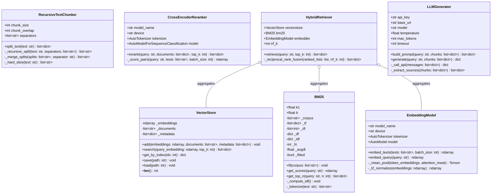
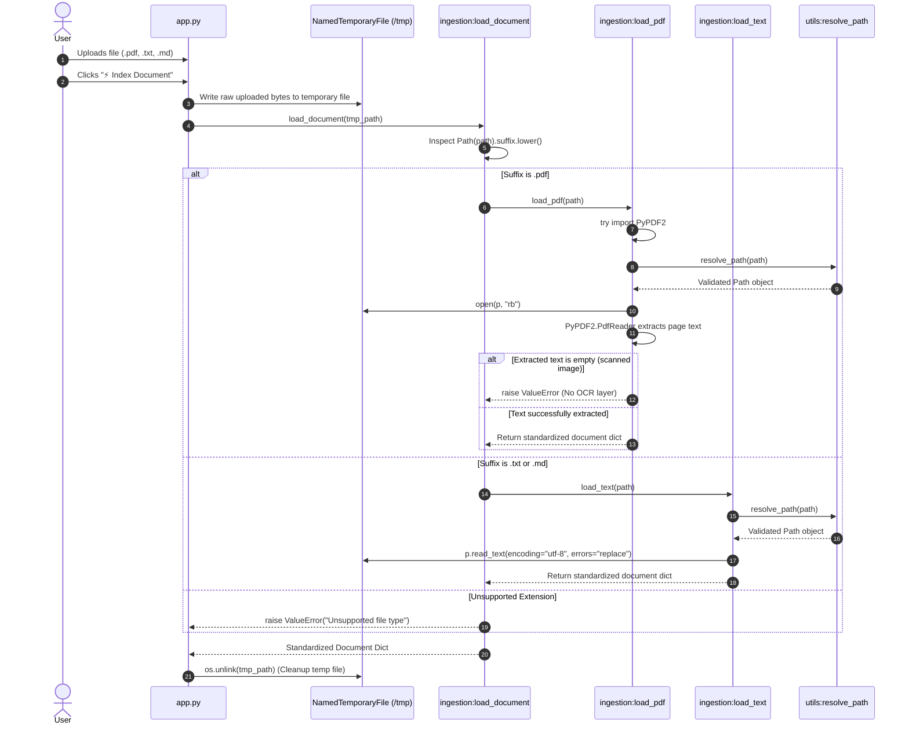
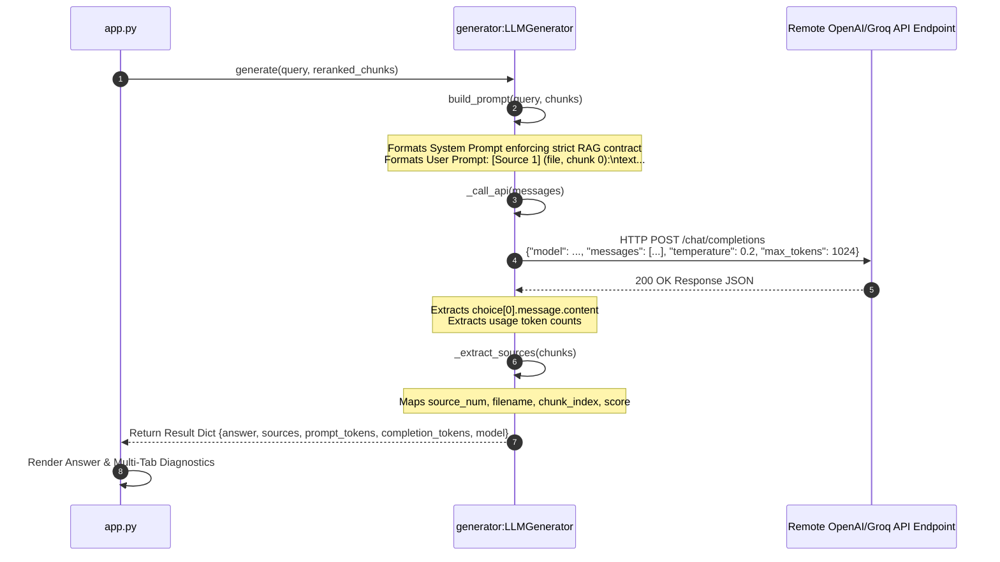
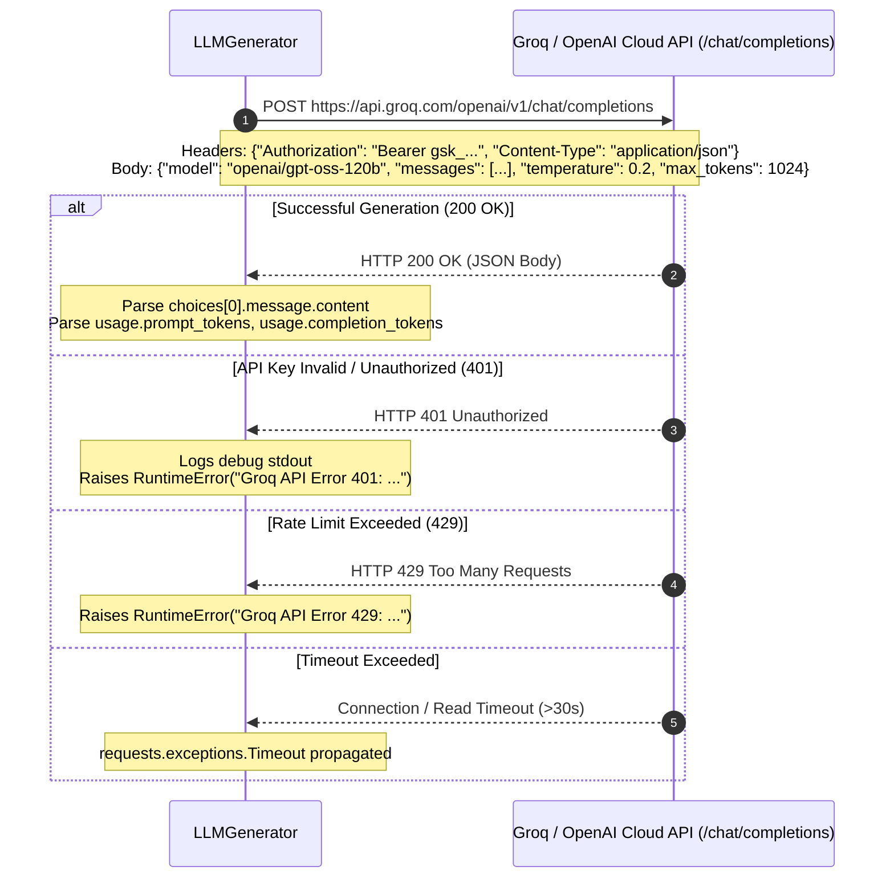
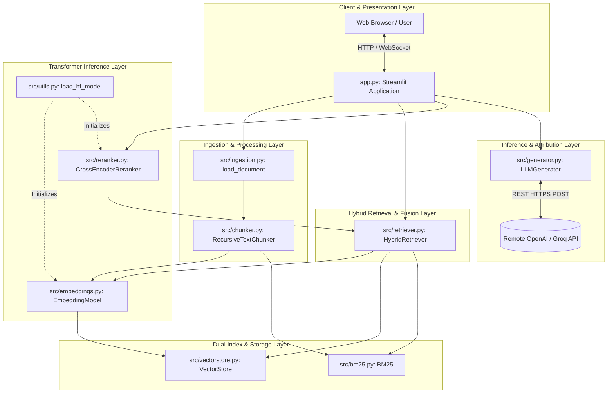
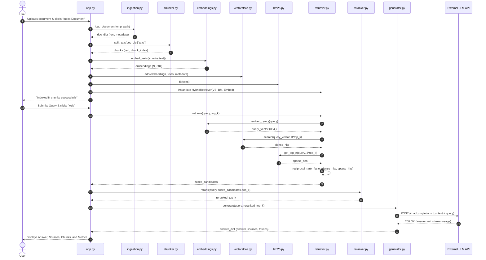
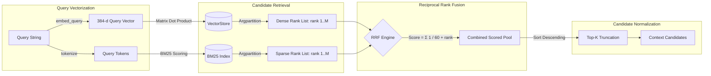

# Comprehensive Reverse Engineering & System Architecture Specification
## Project: `Rag_From_Scratch` (First-Principles Modular RAG System)

---

### Executive Architectural Summary

The **`Rag_From_Scratch`** repository is a purpose-built, first-principles implementation of a production-grade Retrieval-Augmented Generation (RAG) system written in pure Python. Its defining engineering constraint is the **complete absence of high-level orchestration frameworks** such as LangChain, LlamaIndex, Haystack, or third-party vector databases (e.g., Chroma, FAISS, Pinecone). 

Instead, the codebase implements the core mathematical, algorithmic, and operational primitives of RAG directly:
* **Lexical Retrieval:** Okapi BM25 ranking model with Robertson-Walker IDF smoothing.
* **Dense Semantic Retrieval:** Bi-encoder transformer embeddings (`all-MiniLM-L6-v2`) with manual attention-mask weighted mean pooling and row-wise $L_2$ normalization.
* **Vector Store:** In-memory NumPy float32 matrix with exact dot-product cosine similarity search and dual-format (`.npz` + `.json`) disk persistence.
* **Hybrid Rank Fusion:** Reciprocal Rank Fusion (RRF, $k=60$) blending sparse and dense candidate lists without score calibration.
* **Cross-Encoder Re-Ranking:** Deep bidirectional cross-attention scoring (`ms-marco-MiniLM-L-6-v2`) over fused candidates.
* **Grounded Generation:** Direct HTTP client (`requests`) targeting OpenAI-compatible completions endpoints with strict grounding system contracts and chunk-level citation attribution.
* **Evaluation Framework:** LLM-free retrieval metrics (Precision@k, Recall@k, F1@k, MRR) and pluggable faithfulness judge harnesses.
* **Presentation Layer:** Reactive Streamlit web application with hardware device auto-detection (CUDA / Apple Silicon MPS / CPU) and resource caching.

---

## 1. Complete Folder Tree with Explanations

```text
/Users/krishgupta/Downloads/Rag_From_Scratch-main/
├── .dockerignore                     # Build exclusion rules for Docker containerization
├── .env                              # Template/placeholder environment configuration file
├── .gitignore                        # Git exclusion rules (caches, virtual environments, binaries)
├── Complete_Guide.md                 # In-depth algorithmic documentation and educational tutorial
├── Dockerfile                        # Multi-stage production container build targeting Python 3.10-slim
├── LICENSE                           # MIT open-source license specification
├── README.md                         # Project overview, architecture diagrams, and benchmark results
├── app.py                            # Streamlit frontend, UI state management, and pipeline wiring
├── requirements.txt                  # Minimal pinned runtime dependencies
├── data/                             # Evaluation datasets and corpus benchmarks
│   ├── benchmark_corpus.txt          # Reference HTTP/1.1 & HTTP/2 specification corpus (30 chunks)
│   ├── benchmark_results.json        # Comparative benchmark output across Dense, Sparse, Hybrid, and Rerank
│   └── test_cases.json               # 25 ground-truth evaluation queries with relevant chunk ID annotations
├── src/                              # Core pipeline domain modules (First-principles implementation)
│   ├── __init__.py                   # Package namespace initializer
│   ├── bm25.py                       # Hand-crafted Okapi BM25 sparse lexical retrieval engine
│   ├── chunker.py                    # Recursive separator-based sliding-window text chunker
│   ├── embeddings.py                 # Transformer bi-encoder embedding model with manual mean-pooling
│   ├── evaluation.py                 # Retrieval metrics (P/R/F1/MRR) and generation faithfulness harness
│   ├── generator.py                  # OpenAI-compatible LLM completion client via raw HTTP POST
│   ├── ingestion.py                  # Document loader and parser (PDF via PyPDF2, TXT, Markdown)
│   ├── reranker.py                   # Cross-encoder precision re-ranking engine via sequence classification
│   ├── retriever.py                  # Hybrid dense-sparse retriever orchestrating Reciprocal Rank Fusion
│   ├── utils.py                      # Cross-cutting primitives (device detection, HF loader, top-k indexer)
│   └── vectorstore.py                # In-memory NumPy vector store with dual-file disk persistence
└── tests/                            # Granular unit test suite (Pytest)
    ├── __init__.py                   # Test package namespace initializer
    ├── conftest.py                   # Pytest fixtures (sample document and chunk factories)
    ├── test_bm25.py                  # Unit tests for BM25 term frequencies, IDF, and edge-case scoring
    ├── test_chunker.py               # Unit tests for recursive chunk boundary splitting and character offsets
    ├── test_embeddings.py            # Unit tests for embedding dimensions, pooling, and L2 normalization
    ├── test_evaluation.py            # Unit tests for information retrieval metrics and suite aggregation
    ├── test_generator.py             # Unit tests for prompt generation, source extraction, and HTTP mocking
    ├── test_ingestion.py             # Unit tests for PDF/TXT ingestion, missing file errors, and dispatching
    ├── test_reranker.py              # Unit tests for cross-encoder pair scoring, batching, and top-k slicing
    ├── test_retriever.py             # Unit tests for hybrid fusion, candidate over-fetching, and hit enrichment
    ├── test_utils.py                 # Unit tests for device detection, path resolution, and top_k_indices
    └── test_vectorstore.py           # Unit tests for NumPy vector storage, cosine dot products, and persistence
```

### Detailed Directory & File Explanations

* **Root Configuration & Containerization:**
  * `Dockerfile`: Configures a headless Python 3.10-slim runtime. Sets environment variables (`PYTHONUNBUFFERED=1`, `PYTHONDONTWRITEBYTECODE=1`), installs dependencies, exposes port `7860` (standard for HuggingFace Spaces), and launches `app.py`.
  * `requirements.txt`: Restrictive dependency manifest specifying only the essential building blocks: `torch>=2.1.0`, `transformers>=4.38.0`, `numpy>=1.26.0`, `PyPDF2>=3.0.0`, `requests>=2.31.0`, `streamlit>=1.33.0`, `pandas>=2.0.0`.
  * `.env`: Zero-byte placeholder file. The application relies primarily on dynamic UI inputs (Streamlit sidebar) and falls back to host environment variables (`GROQ_API_KEY`).
* **Source Code (`src/`):**
  * Contains the domain logic organized into decoupled, single-responsibility modules. No module in `src/` imports `app.py` or relies on Streamlit APIs, ensuring clean separation of presentation and domain layers.
* **Evaluation & Benchmark Data (`data/`):**
  * Houses a self-contained evaluation benchmark based on RFC-style HTTP documentation (`benchmark_corpus.txt`). `test_cases.json` pairs 25 real-world queries with ground-truth chunk indices. `benchmark_results.json` preserves frozen empirical evaluation runs demonstrating MRR improvement from Sparse (0.893) to Hybrid + Cross-Encoder (1.000).
* **Automated Test Suite (`tests/`):**
  * 10 independent test modules totaling over 1,880 lines of unit tests. Heavy dependencies (PyTorch models) are mocked in retriever and generator tests for near-instant execution, while dedicated integration tests (`test_embeddings.py`, `test_reranker.py`) validate tensor dimensions against actual Hugging Face model checkpoints.

---

## 2. Every Python Module and Its Responsibility

| Module | Core Classes / Functions | Primary Responsibility | Upstream Dependencies | Downstream Consumers |
| :--- | :--- | :--- | :--- | :--- |
| **`src/utils.py`** | `detect_device()`, `load_hf_model()`, `move_to_device()`, `resolve_path()`, `source_basename()`, `top_k_indices()` | Foundational platform utilities: hardware acceleration detection, unified Hugging Face loader, tensor device placement, path verification, and $O(N)$ top-k index selection. | `torch`, `transformers`, `numpy`, `pathlib`, `os` | `embeddings.py`, `reranker.py`, `bm25.py`, `vectorstore.py`, `ingestion.py`, `generator.py`, `app.py` |
| **`src/ingestion.py`** | `load_pdf()`, `load_text()`, `load_document()` | File ingestion and plain text extraction. Dispatches on file extension (`.pdf`, `.txt`, `.md`), enforces OCR/text validation, and normalizes payloads into a standardized document dictionary. | `PyPDF2`, `pathlib`, `src.utils` | `app.py` |
| **`src/chunker.py`** | `RecursiveTextChunker` | Deterministic structural segmentation. Recursively splits text along prioritized boundary separators (`\n\n`, `\n`, `. `, ` `) and aggregates pieces via a double-ended queue (`collections.deque`) sliding window while preserving exact character offsets. | `collections.deque` | `app.py` |
| **`src/embeddings.py`** | `EmbeddingModel` | Dense vector representation. Loads bi-encoder transformer (`all-MiniLM-L6-v2`) via raw HuggingFace `AutoModel`, executes attention-weighted mean pooling, and normalizes output rows to unit length ($L_2$). | `torch`, `transformers`, `numpy`, `src.utils` | `retriever.py`, `app.py` |
| **`src/bm25.py`** | `BM25` | Sparse lexical ranking. Implements Okapi BM25 with Robertson-Walker smoothed IDF ($+1$), term saturation ($k_1=1.5$), document length normalization ($b=0.75$), and punctuation-free whitespace tokenization. | `numpy`, `math`, `string`, `collections.Counter`, `src.utils` | `retriever.py`, `app.py` |
| **`src/vectorstore.py`** | `VectorStore` | In-memory exact similarity search and storage. Maintains a contiguous NumPy matrix of $L_2$-normalized vectors; performs cosine similarity via single matrix-vector product (`embeddings @ query`); serializes to `.npz` and `.json`. | `numpy`, `json`, `pathlib`, `src.utils` | `retriever.py`, `app.py` |
| **`src/reranker.py`** | `CrossEncoderReranker` | Precision passage re-ranking. Loads `ms-marco-MiniLM-L-6-v2` via `AutoModelForSequenceClassification` to score full joint cross-attention between query and passage tokens in mini-batches. | `torch`, `transformers`, `numpy`, `src.utils` | `app.py` |
| **`src/retriever.py`** | `HybridRetriever` | Hybrid retrieval orchestration. Queries `VectorStore` (dense) and `BM25` (sparse) with a $3\times$ over-fetch factor, fuses ranking positions using Reciprocal Rank Fusion ($k=60$), and reconstitutes document metadata. | `src.bm25`, `src.embeddings`, `src.vectorstore` | `app.py` |
| **`src/generator.py`** | `LLMGenerator` | Grounded answer generation. Formulates structured chat completions prompts with explicit citation rules (`[Source N]`), executes raw HTTP POST requests to OpenAI-compatible endpoints, and extracts source attribution metadata. | `requests`, `src.utils` | `app.py` |
| **`src/evaluation.py`** | `compute_retrieval_metrics()`, `_compute_mrr()`, `compute_faithfulness()`, `run_evaluation_suite()` | Offline evaluation harness. Evaluates IR ranking performance (Precision@k, Recall@k, F1@k, MRR) against ground-truth IDs and wraps pluggable generation faithfulness judges. | `typing` | Benchmark scripts, unit tests |
| **`app.py`** | `init_session_state()`, `load_embedding_model()`, `load_reranker()` | Full application lifecycle, Streamlit UI rendering, reactive session state management, pipeline wiring, custom CSS injection, and multi-tab result inspection. | `streamlit`, `pandas`, `src.*` | Web Browser / End-User |

---

## 3. Execution Flow from Application Startup Until Answer Generation

The execution lifecycle comprises three sequential phases: **Initialization**, **Document Ingestion & Indexing**, and **Query Retrieval & Generation**.

```text
[Streamlit Server Boot]
       │
       ▼
app.py top-level execution ──> st.set_page_config() ──> Inject CUSTOM_CSS
       │
       ▼
init_session_state() ──> Initialise st.session_state keys (vectorstore, bm25, retriever, chat_history)
       │
       ▼
Render UI Sidebar & Main Container
       │
       ├──────────────────────────────────────────────────────────────────┐
       │ (Phase 1: Ingestion & Indexing)                                  │ (Phase 2: Query & Generation)
       ▼                                                                  ▼
User uploads file & clicks "⚡ Index Document"                       User types query & clicks "Ask ▶"
       │                                                                  │
       ▼                                                                  ▼
Write bytes to NamedTemporaryFile (/tmp)                             Retrieve hybrid candidates
       │                                                             HybridRetriever.retrieve(query, top_k)
       ▼                                                                  │
load_document(tmp_path)                                                   ├─> embedder.embed_query(query)
       ├─> resolve_path()                                                 ├─> vectorstore.search(q_vec, 3*k)
       ├─> load_pdf() / load_text()                                       ├─> bm25.get_top_n(query, 3*k)
       └─> os.unlink(tmp_path)                                            └─> _reciprocal_rank_fusion()
       │                                                                  │
       ▼                                                                  ▼
RecursiveTextChunker.split_text()                                    CrossEncoderReranker.rerank(query, candidates)
       ├─> _recursive_split()                                             ├─> Tokenize (query, text) pairs
       └─> _merge_splits() via deque                                      ├─> Forward pass: model(**encoded).logits
       │                                                                  └─> Sort descending by logit score
       ▼                                                                  │
EmbeddingModel.embed_texts()                                              ▼
       ├─> AutoTokenizer encoding (padding, truncation)              LLMGenerator.generate(query, reranked)
       ├─> move_to_device()                                               ├─> build_prompt() with [Source N]
       ├─> AutoModel forward pass (no_grad)                               ├─> _call_api() POST /chat/completions
       ├─> _mean_pool(last_hidden_state, mask)                            ├─> Extract answer and token counts
       └─> _l2_normalize()                                                └─> _extract_sources() metadata
       │                                                                  │
       ▼                                                                  ▼
VectorStore.add(embeddings, texts, metadata)                         Prepend result to chat_history
BM25.fit(texts) ──> TF, DF, Robertson-Walker IDF                          │
       │                                                                  ▼
       ▼                                                             Render Q&A card, chunks, sources, metrics
Instantiate HybridRetriever(vs, bm, embedder)
Save instances to st.session_state
```

---

## 4. Function Call Graph

```text
app.py:main
│
├── [Indexing Phase]
│   ├── src.ingestion:load_document(path)
│   │   ├── src.utils:resolve_path(path)
│   │   ├── src.ingestion:load_pdf(path)
│   │   │   └── PyPDF2.PdfReader.pages[].extract_text()
│   │   └── src.ingestion:load_text(path)
│   │       └── pathlib.Path.read_text()
│   │
│   ├── src.chunker:RecursiveTextChunker.split_text(text)
│   │   ├── src.chunker:RecursiveTextChunker._recursive_split(text, separators)
│   │   │   ├── str.split(separator)
│   │   │   ├── src.chunker:RecursiveTextChunker._merge_splits(splits, separator)
│   │   │   └── src.chunker:RecursiveTextChunker._hard_slice(text)
│   │   └── str.find(chunk, cursor)
│   │
│   ├── app.py:load_embedding_model() [@st.cache_resource]
│   │   └── src.embeddings:EmbeddingModel.__init__()
│   │       ├── src.utils:load_hf_model(model_name, AutoModel, device)
│   │       │   ├── src.utils:detect_device()
│   │       │   ├── transformers.AutoTokenizer.from_pretrained()
│   │       │   ├── transformers.AutoModel.from_pretrained()
│   │       │   ├── torch.nn.Module.eval()
│   │       │   └── torch.nn.Module.to(device)
│   │
│   ├── src.embeddings:EmbeddingModel.embed_texts(texts)
│   │   ├── transformers.AutoTokenizer.__call__()
│   │   ├── src.utils:move_to_device(encoded, device)
│   │   ├── transformers.AutoModel.__call__(**encoded) [torch.no_grad]
│   │   ├── src.embeddings:EmbeddingModel._mean_pool(last_hidden_state, attention_mask)
│   │   └── src.embeddings:EmbeddingModel._l2_normalize(embeddings)
│   │
│   ├── src.vectorstore:VectorStore.add(embeddings, documents, metadata)
│   │   └── numpy.concatenate()
│   │
│   ├── src.bm25:BM25.fit(corpus)
│   │   ├── src.bm25:BM25._tokenize(doc)
│   │   ├── collections.Counter(tokens)
│   │   └── src.bm25:BM25._compute_idf()
│   │
│   └── src.retriever:HybridRetriever.__init__(vs, bm, embedder)
│
└── [Query & Retrieval Phase]
    ├── src.retriever:HybridRetriever.retrieve(query, top_k)
    │   ├── src.embeddings:EmbeddingModel.embed_query(query)
    │   │   └── src.embeddings:EmbeddingModel.embed_texts([query])
    │   ├── src.vectorstore:VectorStore.search(query_vec, top_k)
    │   │   ├── numpy.ndarray.@(query) [Matrix-Vector Dot Product]
    │   │   └── src.utils:top_k_indices(scores, k)
    │   │       └── numpy.argpartition() / numpy.argsort()
    │   ├── src.bm25:BM25.get_top_n(query, n)
    │   │   ├── src.bm25:BM25.get_scores(query)
    │   │   │   └── src.bm25:BM25._tokenize(query)
    │   │   └── src.utils:top_k_indices(scores, n)
    │   ├── src.retriever:HybridRetriever._reciprocal_rank_fusion(ranked_lists, rrf_k)
    │   └── src.vectorstore:VectorStore.get_by_index(idx)
    │
    ├── app.py:load_reranker() [@st.cache_resource]
    │   └── src.reranker:CrossEncoderReranker.__init__()
    │       └── src.utils:load_hf_model(model_name, AutoModelForSequenceClassification, device)
    │
    ├── src.reranker:CrossEncoderReranker.rerank(query, documents, top_k)
    │   ├── src.reranker:CrossEncoderReranker._score_pairs(query, texts)
    │   │   ├── transformers.AutoTokenizer.__call__(queries, texts)
    │   │   ├── src.utils:move_to_device(encoded, device)
    │   │   └── transformers.AutoModelForSequenceClassification.__call__() [torch.no_grad]
    │   └── list.sort(key=rerank_score, reverse=True)
    │
    ├── src.generator:LLMGenerator.__init__(api_key, base_url, model)
    │
    └── src.generator:LLMGenerator.generate(query, chunks)
        ├── src.generator:LLMGenerator.build_prompt(query, chunks)
        │   └── src.utils:source_basename(meta)
        ├── src.generator:LLMGenerator._call_api(messages)
        │   └── requests.post(url, headers, json, timeout)
        └── src.generator:LLMGenerator._extract_sources(chunks)
            └── src.utils:source_basename(meta)
```

---

## 5. Class Dependency Graph



---

## 6. Data Flow Diagram

The diagram below documents the progressive transformation of data structures, dictionary keys, and tensor dimensions across the end-to-end pipeline:

```mermaid
flowchart TD
    subgraph Ingestion_Stage [Stage 1: Ingestion & Extraction]
        A1[Raw Document: PDF / TXT / MD] -->|load_document| A2["Standardized Document Dict:<br/>• text: str<br/>• filename: str<br/>• num_pages: int | None<br/>• metadata: {source: str, file_type: str, pages: int}"]
    end

    subgraph Chunking_Stage [Stage 2: Semantic Segmentation]
        A2 -->|RecursiveTextChunker.split_text| B1["Raw Chunk Dicts:<br/>• text: str (len <= 512)<br/>• chunk_index: int<br/>• start_char: int<br/>• end_char: int"]
        B1 -->|Metadata Injection| B2["Enriched Chunk Dicts:<br/>• text: str<br/>• metadata: {source, filename, chunk_index, file_type}"]
    end

    subgraph Embedding_Stage [Stage 3: Dense & Sparse Indexing]
        B2 -->|Extract texts| C1["list[str] (N items)"]
        C1 -->|EmbeddingModel.embed_texts| C2["NumPy ndarray (N, 384)<br/>dtype: float32, L2-normalized"]
        C2 -->|VectorStore.add| C3[(VectorStore In-Memory:<br/>_embeddings: ndarray(N,384)<br/>_documents: list[str]<br/>_metadata: list[dict])]
        C1 -->|BM25.fit| C4[(BM25 In-Memory:<br/>_tf: list[Counter]<br/>_df: dict[str, int]<br/>_idf: dict[str, float]<br/>_dl: list[int])]
    end

    subgraph Retrieval_Stage [Stage 4: Hybrid Search & RRF]
        D1[User Query: str] -->|embed_query| D2["Query Vector: ndarray (384,)"]
        D2 & C3 -->|VectorStore.search| D3["Dense Candidates (3*k):<br/>[{text, metadata, score, index}]"]
        D1 & C4 -->|BM25.get_top_n| D4["Sparse Candidates (3*k):<br/>[{text, score, index}]"]
        D3 & D4 -->|_reciprocal_rank_fusion| D5["Fused Candidates (top_k):<br/>[{text, metadata, score: rrf_score, index}]"]
    end

    subgraph Reranking_Stage [Stage 5: Cross-Encoder Scoring]
        D1 & D5 -->|CrossEncoderReranker.rerank| E1["Reranked Candidates (top_k):<br/>[{text, metadata, score, index, rerank_score: float}]"]
    end

    subgraph Generation_Stage [Stage 6: Grounded LLM Generation]
        D1 & E1 -->|LLMGenerator.build_prompt| F1["OpenAI Messages Payload:<br/>[system_message, user_message_with_Source_N]"]
        F1 -->|LLMGenerator._call_api| F2["Raw API Response JSON:<br/>{choices: [...], usage: {prompt_tokens, completion_tokens}}"]
        F2 & E1 -->|LLMGenerator.generate| F3["Final Generation Result Dict:<br/>• answer: str<br/>• sources: [{source_num, filename, chunk_index, score}]<br/>• prompt_tokens: int<br/>• completion_tokens: int<br/>• model: str<br/>• chunks: list[dict]"]
    end
```

---

## 7. Configuration Files and How They Interact

The repository features three primary configuration targets:

```text
       ┌────────────────────────┐
       │     Dockerfile         │
       │ (Platform Environment) │
       └───────────┬────────────┘
                   │ Defines runtime base, Python version,
                   │ port bindings (7860), and default CMD
                   ▼
       ┌────────────────────────┐
       │    requirements.txt    │
       │ (Package Dependencies) │
       └───────────┬────────────┘
                   │ Installed into Docker image or local venv;
                   │ dictates strict semantic version bounds
                   ▼
       ┌────────────────────────┐
       │   Streamlit Runtime    │
       │  (app.py UI Settings)  │
       └───────────┬────────────┘
                   │ Overrides default runtime parameters
                   │ (API key, Base URL, Model ID, top_k)
                   ▼
       ┌────────────────────────┐
       │    Groq / OpenAI API   │
       │   (Remote LLM Host)    │
       └────────────────────────┘
```

1. **`Dockerfile`**:
   * Base image: `python:3.10-slim`.
   * Environment variables:
     * `PYTHONDONTWRITEBYTECODE=1`: Suppresses `.pyc` generation to keep image layers lean.
     * `PYTHONUNBUFFERED=1`: Ensures stdout/stderr flush immediately to container logs.
     * `STREAMLIT_SERVER_HEADLESS=true`: Forces Streamlit to run non-interactively without attempting to spawn browser windows.
     * `STREAMLIT_SERVER_PORT=7860`: Explicitly binds to port 7860 to comply with HuggingFace Spaces hosting standards.
     * `STREAMLIT_SERVER_ADDRESS=0.0.0.0`: Binds all network interfaces inside the container.
2. **`requirements.txt`**:
   * Defines the foundational mathematical and ML stack.
   * `torch>=2.1.0` and `transformers>=4.38.0` provide the tensor execution engine and tokenizer runtime.
   * `numpy>=1.26.0` powers all vector dot products and argpartition operations.
   * `PyPDF2>=3.0.0` handles binary stream parsing for PDF uploads.
   * `requests>=2.31.0` manages synchronous outbound HTTP requests.
   * `streamlit>=1.33.0` and `pandas>=2.0.0` drive the web interface and tabular displays.
3. **Environment Variables & Secrets (`.env` vs UI)**:
   * `.env` is an empty stub in repository root.
   * `app.py` inspects `os.environ.get("GROQ_API_KEY")` solely to determine whether the sidebar configuration accordion should default to expanded or collapsed. The actual API key, Base URL (`https://api.groq.com/openai/v1`), and model identifier (`openai/gpt-oss-120b`) are collected directly through `st.text_input` in the UI session.

---

## 8. Model Loading Lifecycle

The application manages two Hugging Face transformer models concurrently. To prevent prohibitive overhead (model weights re-downloading or re-initializing on every Streamlit script re-run), loading is wrapped in `@st.cache_resource`.

```text
[Streamlit App Launch]
       │
       ▼
app.py initializes functions load_embedding_model() & load_reranker()
decorated with @st.cache_resource(show_spinner=...)
       │
       ├────────────────────────────────────────────────────────┐
       ▼                                                        ▼
[Invocation 1: Embedding Model]                          [Invocation 2: Cross-Encoder]
EmbeddingModel.__init__()                                CrossEncoderReranker.__init__()
       │                                                        │
       ▼                                                        ▼
src.utils:load_hf_model(model_name, model_class, device) ───────┘
       │
       ├── 1. Device Resolution:
       │      detect_device() evaluates:
       │      ├─> torch.cuda.is_available() ──> "cuda"
       │      ├─> torch.backends.mps.is_available() ──> "mps" (Apple Silicon)
       │      └─> Fallback ──> "cpu"
       │
       ├── 2. Tokenizer Instantiation:
       │      AutoTokenizer.from_pretrained(model_name)
       │      Cached locally in ~/.cache/huggingface/hub/
       │
       ├── 3. Model Weight Loading:
       │      model_class.from_pretrained(model_name)
       │      • Embedding: AutoModel ("sentence-transformers/all-MiniLM-L6-v2", ~90MB)
       │      • Reranker: AutoModelForSequenceClassification ("cross-encoder/ms-marco-MiniLM-L-6-v2", ~85MB)
       │
       ├── 4. Evaluation State Enforcement:
       │      model.eval() (disables dropout and batch normalization updates)
       │
       └── 5. Device Migration:
              model.to(device) (transfers FP32 weights to target accelerator VRAM/RAM)
       │
       ▼
Streamlit Resource Registry:
Instances preserved in memory across all user interactions and session reruns.
```

---

## 9. Document Ingestion Lifecycle

The document ingestion pipeline standardizes heterogeneous unstructured files into uniform structured document objects.



---

## 10. Retrieval Pipeline

The retrieval engine employs a multi-stage **Dense + Sparse Hybrid Search** fused via **Reciprocal Rank Fusion (RRF)**, followed by **Cross-Encoder Re-Ranking**.

```mermaid
flowchart TD
    Q[User Query String] --> E[EmbeddingModel.embed_query]
    Q --> B[BM25._tokenize]

    subgraph Dense_Retrieval [Branch A: Dense Semantic Search]
        E -->|L2 Normalized Vector| VS[VectorStore.search]
        VS -->|Matrix Multiply: _embeddings @ query| DP[Cosine Dot Product Scores]
        DP -->|top_k_indices: argpartition| DR[Dense Candidates: top 3*k]
    end

    subgraph Sparse_Retrieval [Branch B: Sparse Lexical Search]
        B -->|Query Terms| BM[BM25.get_scores]
        BM -->|Sum Robertson-Walker IDF * TF Component| BS[BM25 Scores]
        BS -->|top_k_indices: argpartition| SR[Sparse Candidates: top 3*k]
    end

    subgraph Hybrid_Fusion [Stage C: Reciprocal Rank Fusion]
        DR & SR --> RRF[HybridRetriever._reciprocal_rank_fusion]
        RRF -->|RRF_score = Σ 1 / 60 + rank| FC[Fused Ranked Candidates]
        FC -->|Enrich Sparse Hits via VectorStore.get_by_index| EC[Enriched Candidates]
    end

    subgraph Cross_Encoder_Stage [Stage D: Precision Re-Ranking]
        Q & EC --> CE[CrossEncoderReranker.rerank]
        CE -->|Construct [CLS] query [SEP] passage [SEP]| Tok[Batch Tokenize max_len=512]
        Tok -->|AutoModelForSequenceClassification| Logits[Raw Relevance Logits]
        Logits -->|Sort Descending| RC[Top-K Final Context Chunks]
    end

    RC --> Out[Delivered to Generation Pipeline]
```

### Mathematical Formulations

1. **Cosine Similarity via Normalized Dot Product (`src/vectorstore.py`):**
   $$\text{cosine\_similarity}(\mathbf{u}, \mathbf{v}) = \frac{\mathbf{u} \cdot \mathbf{v}}{\|\mathbf{u}\|_2 \|\mathbf{v}\|_2} = \mathbf{u}_{\text{norm}} \cdot \mathbf{v}_{\text{norm}}$$
   Because all rows in `VectorStore._embeddings` are pre-normalized upon insertion via `_l2_normalize()`, similarity search reduces to an optimized BLAS matrix-vector multiplication:
   $$\mathbf{s} = \mathbf{E} \cdot \mathbf{q}$$
2. **Okapi BM25 Scoring (`src/bm25.py`):**
   $$\text{score}(D, Q) = \sum_{t \in Q} \text{IDF}(t) \cdot \frac{f(t, D) \cdot (k_1 + 1)}{f(t, D) + k_1 \cdot \left(1 - b + b \cdot \frac{|D|}{\text{avgdl}}\right)}$$
   Where $k_1 = 1.5$, $b = 0.75$, and Robertson-Walker IDF with exterior smoothing is defined as:
   $$\text{IDF}(t) = \ln\left(\frac{N - n(t) + 0.5}{n(t) + 0.5} + 1\right)$$
3. **Reciprocal Rank Fusion (`src/retriever.py`):**
   $$\text{RRF\_Score}(d) = \sum_{m \in M} \frac{1}{k_{\text{rrf}} + r_m(d)}$$
   Where $k_{\text{rrf}} = 60$, $M = \{\text{Dense}, \text{Sparse}\}$, and $r_m(d) \in [1, K]$ is the 1-based rank position of document $d$ in ranking list $m$.

---

## 11. Generation Pipeline

The generation stage grounds LLM output strictly within the retrieved context, forcing citation transparency.



### Prompt Construction Template

* **System Prompt:**
  ```text
  You are a precise question-answering assistant. Answer questions using ONLY the provided context. If the context does not contain enough information to answer, say "I don't have enough information in the provided documents to answer this question." Do not speculate or use knowledge outside the provided context. Cite sources using [Source N] notation where N matches the context block number.
  ```
* **User Prompt Structure:**
  ```text
  Context:

  [Source 1] (rfc2616.txt, chunk 4):
  The GET method means retrieve whatever information...

  [Source 2] (rfc2616.txt, chunk 28):
  Methods can also have the property of "idempotence"...

  Question: Is the GET method idempotent?
  ```

---

## 12. Storage Pipeline

The repository rejects third-party vector databases in favor of an **in-memory contiguous NumPy array backed by dual-file disk serialization**.

```text
               VectorStore Memory Layout
      ┌──────────────────────────────────────────┐
      │  _embeddings: np.ndarray                 │
      │  Shape: (N, 384), dtype: float32         │
      │  Contiguous, L2-normalized rows          │
      ├──────────────────────────────────────────┤
      │  _documents: list[str]                   │
      │  Raw string chunks (len = N)             │
      ├──────────────────────────────────────────┤
      │  _metadata: list[dict]                   │
      │  Arbitrary chunk metadata dicts (len = N)│
      └─────────────────────┬────────────────────┘
                            │
               ┌────────────┴────────────┐
               │                         │
        save(path + ".npz")       save(path + ".json")
               │                         │
               ▼                         ▼
     ┌───────────────────┐     ┌───────────────────┐
     │   {path}.npz      │     │   {path}.json     │
     │ Compressed NumPy  │     │ UTF-8 JSON Array  │
     │ Binary Archive    │     │ Document Strings  │
     │ Key: "embeddings" │     │ & Metadata Dicts  │
     └───────────────────┘     └───────────────────┘
```

* **Persistence Mechanics (`src/vectorstore.py`):**
  * **Embeddings Matrix:** Serialized via `numpy.savez_compressed(f"{path}.npz", embeddings=self._embeddings)`. If empty, persists an empty array of shape `(0, 0)`.
  * **Text & Metadata:** Serialized via `json.dumps(payload, ensure_ascii=False, indent=2)` where payload maps `[{"document": doc, "metadata": meta}, ...]`.
  * **Loading:** `load(path)` reads both files simultaneously, restoring FP32 vectors and verifying structural synchronization via matching array lengths.

---

## 13. API Flow

The application interfaces with external LLM inference providers via a pure REST protocol without vendor SDK wrappers.



---

## 14. Dead Code Identification

A comprehensive static analysis and runtime audit reveals the following dead, unreachable, or unconsumed code:

1. **Unreachable / Unimplemented UI Pipeline Step Indicator (`app.py:415`):**
   ```python
   pipeline_steps = [
       ("📤", "Upload", st.session_state["indexed_filename"] is not None),
       ("✂️", "Chunk", st.session_state["chunk_count"] > 0),
       ("🧠", "Index", st.session_state["retriever"] is not None),
       ("🔑", "API Key", False),  # placeholder, updated below
   ]
   ```
   *Defect:* The comment explicitly states `# placeholder, updated below`. However, `pipeline_steps` is never updated or modified later in `app.py`. The "API Key" indicator remains permanently hardcoded to `False` (`⏳ Pending`), even when the user inputs a valid API key.
2. **Duplicate Library Import (`app.py:16` vs `app.py:544`):**
   * `import pandas as pd` is executed globally at line 16 of `app.py`.
   * At line 544, inside `with tab_sources:`, `import pandas as pd` is redundantly executed a second time.
3. **Unreachable Progress Bar Branch & Unlisted Dependency (`src/embeddings.py:66-72`):**
   ```python
   if show_progress:
       try:
           from tqdm import tqdm
           batches = tqdm(batches, desc="Embedding")
       except ImportError:
           pass
   ```
   *Defect:* In `app.py:302`, `embed_texts()` is explicitly called with `show_progress=False`. `tqdm` is never imported in production, and `tqdm` is not included in `requirements.txt`.
4. **Unconsumed Evaluation Parameter (`src/evaluation.py:144`):**
   * In `test_cases.json` and `test_evaluation.py`, test cases define `"reference_answer": str`. In `src/evaluation.py:run_evaluation_suite()`, this key is completely ignored and unconsumed by the evaluation loop.
5. **Dormant Empty File (`.env`):**
   * The `.env` file in the workspace root is a 0-byte blank file that plays no role in runtime execution.

---

## 15. Duplicated Logic Identification

1. **Path Basename Extraction (`src/utils.py:source_basename`):**
   * `src/utils.py` provides `source_basename(meta)`.
   * However, `app.py:529` and `src/generator.py:80, 186` repeatedly unpack `chunk.get("metadata", {})` and pass it to `source_basename(meta)`, replicating the metadata dictionary retrieval boilerplate across multiple files.
2. **Hugging Face Model Initialization State (`src/embeddings.py` & `src/reranker.py`):**
   * Both `EmbeddingModel` and `CrossEncoderReranker` duplicate identical attribute bindings:
     ```python
     self.model_name = model_name
     self.tokenizer, self.model, self.device = load_hf_model(model_name, ..., device)
     ```
   * Both classes maintain duplicate `__repr__` implementations printing model name and device.
3. **Top-K Sorting Divergence:**
   * `src/utils.py` contains an optimized $O(N)$ partitioning function: `top_k_indices(scores, k)`.
   * While `VectorStore.search()` and `BM25.get_top_n()` correctly utilize `top_k_indices()`, `CrossEncoderReranker.rerank()` ignores it entirely, instead relying on Python's built-in list sort `reranked.sort(key=lambda x: x["rerank_score"], reverse=True)` followed by slice truncation `[:top_k]`.
4. **Redundant Path Existence Verification:**
   * `src/ingestion.py:load_document()` resolves the file extension via `Path(path).suffix.lower()`.
   * Subsequently, both `load_pdf()` and `load_text()` independently call `resolve_path(path)`, executing `Path.resolve()` and filesystem existence checks twice per document.

---

## 16. Technical Debt Identification

1. **Security & Privacy Leak via Stdout Print Logging (`src/generator.py:146-160`):**
   ```python
   print("\n========== GROQ DEBUG ==========")
   print("URL:", url)
   print("MODEL:", self.model)
   print("API KEY PRESENT:", bool(self.api_key))
   ...
   print("STATUS:", response.status_code)
   print("RESPONSE:", response.text)
   print("================================\n")
   ```
   *Architectural Risk:* Unfiltered debug logging prints sensitive user prompts, internal document contents, and LLM completions directly to stdout. In a hosted container or production logging environment, this leaks proprietary document chunks.
2. **Hardcoded Vendor Coupling in Error Handling (`src/generator.py:163-165`):**
   ```python
   if not response.ok:
       raise RuntimeError(f"Groq API Error {response.status_code}: {response.text}")
   ```
   *Architectural Risk:* The module docstrings claim support for any OpenAI-compatible provider (Together, OpenAI, vLLM). However, the runtime exception explicitly hardcodes `"Groq API Error"`.
3. **Broken Exception Handling Contract Causing Test Failure (`tests/test_generator.py:183`):**
   * `LLMGenerator._call_api` was refactored to inspect `if not response.ok: raise RuntimeError(...)` instead of calling `response.raise_for_status()`.
   * This broke the established error contract: `test_http_error_propagates` in `tests/test_generator.py` explicitly expects `requests.exceptions.HTTPError`. As a result, the test fails.
4. **Cross-Platform Incompatibility with Windows File Paths (`src/utils.py:108`):**
   ```python
   def source_basename(meta: dict[str, Any]) -> str:
       raw = meta.get("source", "unknown")
       return os.path.basename(raw) if raw != "unknown" else "unknown"
   ```
   *Architectural Risk:* On POSIX operating systems (macOS, Linux), `os.path.basename` uses `/` as the separator and does not recognize Windows `\` separators. A path such as `C:\Users\docs\file.txt` returns the entire string unchanged, causing `tests/test_utils.py:test_source_basename_windows_path` to fail on macOS and Linux.
5. **Premature Import Before File Existence Check (`src/ingestion.py:48-52`):**
   * `load_pdf` attempts `import PyPDF2` before calling `resolve_path(path)`. If `PyPDF2` is not installed, calling `load_pdf("/invalid/path.pdf")` raises an `ImportError` rather than `FileNotFoundError`, violating standard error precedence.
6. **Hardcoded Vendor-Specific Default Model (`app.py:364`):**
   * The UI default model string is set to `"openai/gpt-oss-120b"`. This is not a standard OpenAI checkpoint; it is a specialized routing identifier on Groq.
7. **Linear Search Scalability Bottleneck ($O(N \cdot D)$):**
   * `VectorStore.search` performs exact brute-force cosine similarity via matrix-vector multiplication. For $N < 10,000$ chunks, this runs in single-digit milliseconds. However, without an Approximate Nearest Neighbor (ANN) index (e.g. HNSW or IVF), memory consumption and latency scale linearly with corpus size.
8. **Volatile Session-Bound Storage:**
   * All ingested indices (`VectorStore`, `BM25`, `HybridRetriever`) live exclusively in `st.session_state`. Refreshing the browser or opening a new tab destroys the index, requiring complete re-ingestion and re-embedding.
9. **Synchronous Blocking I/O:**
   * Document parsing, tensor embedding, and remote HTTP requests execute synchronously on the main thread, blocking the Streamlit event loop during long-running tasks.
10. **Deprecated Dependency (`PyPDF2`):**
    * `PyPDF2` has been deprecated and merged into `pypdf`. Continued reliance on `PyPDF2>=3.0.0` incurs long-term maintenance vulnerability.

---

## 17. External Dependencies and Why They Exist

| Package | Minimum Specified Version | Architectural Purpose | Why It Cannot Be Omitted |
| :--- | :--- | :--- | :--- |
| **`torch`** | `>=2.1.0` | Deep learning execution framework. Manages device acceleration (CUDA, MPS, CPU), tensor allocations, and backward-compatible inference graphs. | Powers the tensor forward passes in `EmbeddingModel` and `CrossEncoderReranker`. |
| **`transformers`** | `>=4.38.0` | Hugging Face model architecture and tokenizer hub client. | Provides `AutoTokenizer`, `AutoModel`, and `AutoModelForSequenceClassification` to execute `all-MiniLM-L6-v2` and `ms-marco-MiniLM-L-6-v2` weights. |
| **`numpy`** | `>=1.26.0` | High-performance contiguous array computing. | Implements the vector database matrix, row-wise vector normalization, dot-product matrix multiplication, and $O(N)$ partitioning (`argpartition`). |
| **`PyPDF2`** | `>=3.0.0` | Binary PDF parsing library. | Extracts text streams and page counts from uploaded PDF documents. |
| **`requests`** | `>=2.31.0` | Synchronous HTTP client. | Dispatches raw JSON POST payloads to OpenAI-compatible `/chat/completions` REST endpoints without third-party SDK bloat. |
| **`streamlit`** | `>=1.33.0` | Reactive web application framework. | Provides the graphical interface, file upload widgets, session state management (`st.session_state`), and resource caching (`@st.cache_resource`). |
| **`pandas`** | `>=2.0.0` | Structured DataFrame library. | Powers the interactive source attribution table rendered in the "📎 Sources" tab of the user interface. |

---

## 18. Architectural & Sequence Mermaid Diagrams

### 18.1 High-Level Component Topology



### 18.2 End-to-End Sequence Flow



### 18.3 Hybrid Retrieval & RRF Fusion Topology


