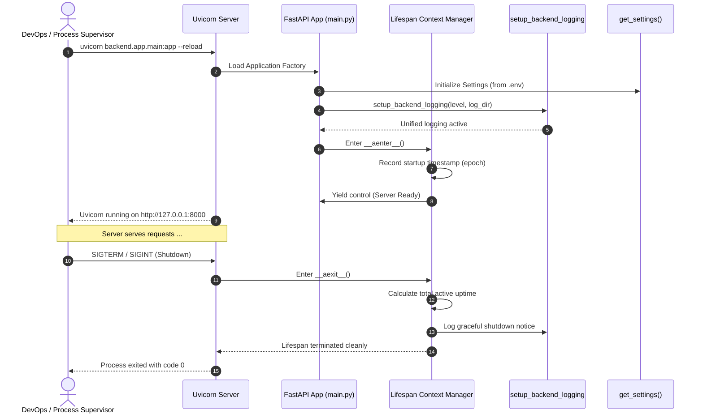
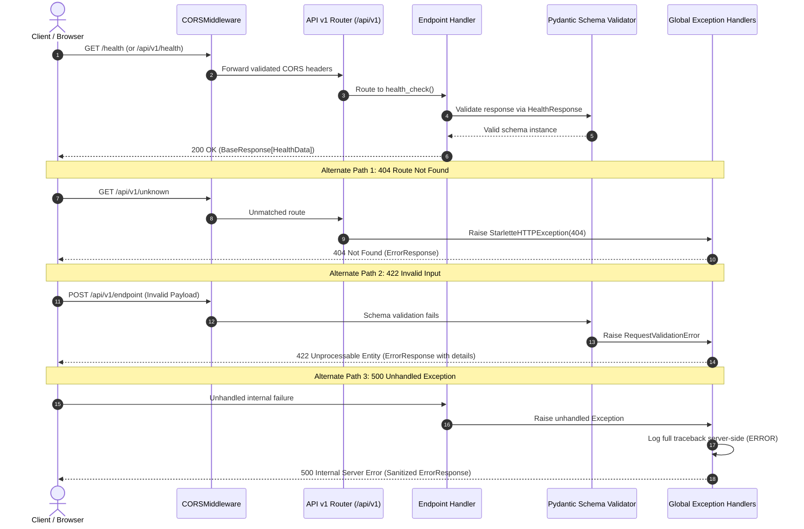

# DocMind AI — Backend Architecture Specification

## 1. Executive Summary

This document specifies the software architecture, design patterns, and operational contracts of the **DocMind AI Backend**.

The backend is built using **FastAPI** to provide enterprise-grade, asynchronous REST APIs for DocMind AI. It introduces a modular, layered infrastructure that strictly decouples web concerns (HTTP routing, validation, CORS, error normalization) from the existing hybrid RAG and document intelligence engine located in [`src/`](file:///Users/krishgupta/Downloads/Rag_From_Scratch-main/src).

---

## 2. Architectural Principles & Quality Attributes

| Principle | Implementation Strategy | Architectural Benefit |
| :--- | :--- | :--- |
| **Separation of Concerns** | Layered architecture: API Routers $\rightarrow$ Schemas $\rightarrow$ Dependencies $\rightarrow$ Domain Engine (`src/`) | Prevents HTTP coupling with AI algorithms; ensures independent testability. |
| **Strict AI Decoupling** | Zero modifications to [`src/`](file:///Users/krishgupta/Downloads/Rag_From_Scratch-main/src). AI singletons are injected via FastAPI dependencies (`deps.py`). | Preserves math invariance and backward compatibility with Streamlit/CLI. |
| **API Versioning** | Isolated sub-routers mounted under `/api/v1` with root service discovery. | Enables progressive deprecation and seamless multi-version client support. |
| **Fail-Safe Normalization** | Global exception handlers mapping all unhandled failures to structured JSON envelopes. | Prevents stack trace leakage to clients while emitting structured logs server-side. |
| **Type Safety & Validation** | Full Pydantic v2 schemas for all requests, responses, and environment variables. | Compile-time and runtime validation; auto-generates OpenAPI 3.1.0 specifications. |
| **Unified Observability** | Centralized backend logging seamlessly bound to `src.logger.configure_logging`. | Consistent timestamps, log rotation, and coordinated log levels with Uvicorn. |

---

## 3. High-Level System Architecture

```mermaid
flowchart TD
    Client(["HTTP Client / Frontend (Browser / Mobile / cURL)"])

    subgraph FastAPIFramework ["DocMind AI FastAPI Service (backend.app.main:app)"]
        subgraph MiddlewarePipeline ["Middleware Pipeline"]
            CORSMiddleware["CORSMiddleware<br/>(Allowed Origins, Methods, Headers)"]
            LifespanContext["Lifespan Context Manager<br/>(Startup & Shutdown Events)"]
        end

        subgraph RoutingLayer ["Routing & API Versioning"]
            RootRouter["Root Router<br/>(GET /, GET /health)"]
            APIV1Router["API v1 Aggregator (/api/v1)<br/>(GET /api/v1/, GET /api/v1/health)"]
            FutureUpload["[Planned] Document Ingestion Router<br/>(/api/v1/documents)"]
            FutureChat["[Planned] RAG & Chat Router<br/>(/api/v1/chat)"]
        end

        subgraph ValidationLayer ["Pydantic Schemas Layer (backend/app/schemas)"]
            CommonSchemas["BaseResponse / ErrorResponse / ErrorDetail"]
            HealthSchemas["HealthResponse / RootResponse"]
        end

        subgraph ExceptionLayer ["Error Handling & Normalization (backend/app/core/errors.py)"]
            DocMindHandler["DocMindAPIException Handler"]
            ValidationHandler["RequestValidationError Handler (422)"]
            HTTPHandler["Starlette/FastAPI HTTPException Handler (404/403/401)"]
            UnhandledHandler["Catch-all Exception Handler (500)"]
        end

        subgraph CoreInfra ["Core Infrastructure (backend/app/core)"]
            SettingsConfig["Settings Singleton<br/>(pydantic-settings, .env)"]
            BackendLogging["Centralized Logging<br/>(backend.app.core.logging)"]
        end

        subgraph DepInjection ["Dependency Injection Layer (backend/app/api/deps.py)"]
            DepSettings["Depends(get_settings)"]
            DepLogger["Depends(get_request_logger)"]
            DepVectorStore["Depends(get_vector_store)"]
            DepRetriever["Depends(get_hybrid_retriever)"]
            DepGenerator["Depends(get_llm_generator)"]
        end
    end

    subgraph AIEngine ["DocMind AI Core Engine (src/) — Strictly Untouched"]
        IngestionMod["Document Loaders & Ingestion<br/>(src/loaders.py, src/ingestion.py)"]
        EmbeddingMod["VectorStore & Embeddings<br/>(src/vectorstore.py, src/embeddings.py)"]
        RetrievalMod["HybridRetriever & Reranker<br/>(src/retriever.py, src/reranker.py)"]
        GenerationMod["LLMGenerator & Telemetry<br/>(src/generator.py, src/retrieval_v2.py)"]
        SharedLogger["Central Logging Engine<br/>(src/logger.py)"]
    end

    Client --> CORSMiddleware
    CORSMiddleware --> RootRouter
    CORSMiddleware --> APIV1Router
    APIV1Router --> FutureUpload
    APIV1Router --> FutureChat

    RootRouter --> HealthSchemas
    APIV1Router --> HealthSchemas

    RootRouter -.-> DepInjection
    APIV1Router -.-> DepInjection

    DepInjection --> DepSettings
    DepInjection --> DepLogger
    DepInjection -. Future Integration .-> IngestionMod
    DepInjection -. Future Integration .-> EmbeddingMod
    DepInjection -. Future Integration .-> RetrievalMod
    DepInjection -. Future Integration .-> GenerationMod

    BackendLogging --> SharedLogger
    RoutingLayer -. Exception .-> ExceptionLayer
    ExceptionLayer --> Client
```



---

## 4. Package & Module Layout

The backend follows the established production FastAPI standard:

```text
backend/
├── README.md                           # Operational and developer documentation
├── __init__.py                         # Root backend package marker
└── app/
    ├── __init__.py                     # Application package marker
    ├── main.py                         # Application entrypoint & factory (app)
    ├── api/
    │   ├── __init__.py                 # API layer marker
    │   ├── deps.py                     # Dependency injection providers (IoC)
    │   └── v1/
    │       ├── __init__.py             # API v1 marker
    │       ├── api.py                  # API v1 top-level router aggregator
    │       └── endpoints/
    │           ├── __init__.py         # Endpoints marker
    │           ├── health.py           # Health check endpoints
    │           └── root.py             # Root discovery endpoints
    ├── core/
    │   ├── __init__.py                 # Core infrastructure marker
    │   ├── config.py                   # Pydantic Settings & environment parsing
    │   ├── errors.py                   # Domain exceptions & global exception handlers
    │   └── logging.py                  # Logging configuration binding to src.logger
    └── schemas/
        ├── __init__.py                 # Schemas marker
        ├── common.py                   # Standard envelope schemas (BaseResponse, ErrorResponse)
        └── health.py                   # Health and service discovery schemas
```

### Module Responsibilities

1. **[`backend/app/main.py`](file:///Users/krishgupta/Downloads/Rag_From_Scratch-main/backend/app/main.py)**:
   - Exposes `app = create_application()`.
   - Manages application lifespan (`@asynccontextmanager lifespan(app)`).
   - Configures `CORSMiddleware` with origins loaded from `Settings`.
   - Mounts global exception handlers via `register_exception_handlers(app)`.
   - Mounts top-level routes (`GET /`, `GET /health`) and versioned sub-routers (`/api/v1`).
2. **[`backend/app/core/config.py`](file:///Users/krishgupta/Downloads/Rag_From_Scratch-main/backend/app/core/config.py)**:
   - Uses `pydantic-settings` (`BaseSettings`, `SettingsConfigDict`).
   - Reads `.env` files dynamically with `DOCMIND_` prefix support and default fallbacks.
   - Robustly parses `DOCMIND_CORS_ORIGINS` across JSON arrays, comma-delimited strings, or wildcards.
   - Memoized via `@lru_cache() get_settings()` for zero-allocation injection.
3. **[`backend/app/core/logging.py`](file:///Users/krishgupta/Downloads/Rag_From_Scratch-main/backend/app/core/logging.py)**:
   - Bridges FastAPI and Uvicorn loggers directly into [`src/logger.py`](file:///Users/krishgupta/Downloads/Rag_From_Scratch-main/src/logger.py).
   - Normalizes handler levels for `uvicorn`, `uvicorn.access`, and `uvicorn.error`.
4. **[`backend/app/core/errors.py`](file:///Users/krishgupta/Downloads/Rag_From_Scratch-main/backend/app/core/errors.py)**:
   - Declares domain exception taxonomy: `DocMindAPIException`, `ResourceNotFoundException`, `ValidationException`, `ServiceUnavailableException`.
   - Registers handlers for `DocMindAPIException`, `RequestValidationError`, `StarletteHTTPException`, `HTTPException`, and generic `Exception`.
   - Guarantees predictable JSON envelope output on all errors.
5. **[`backend/app/schemas/common.py`](file:///Users/krishgupta/Downloads/Rag_From_Scratch-main/backend/app/schemas/common.py)**:
   - Defines generic response container `BaseResponse[T]`.
   - Defines structured error schemas `ErrorResponse` and `ErrorDetail`.
6. **[`backend/app/schemas/health.py`](file:///Users/krishgupta/Downloads/Rag_From_Scratch-main/backend/app/schemas/health.py)**:
   - Models `HealthData`, `HealthResponse`, `RootData`, and `RootResponse`.
7. **[`backend/app/api/deps.py`](file:///Users/krishgupta/Downloads/Rag_From_Scratch-main/backend/app/api/deps.py)**:
   - Inversion of Control (IoC) dependency provider.
   - Provides `get_settings()` and `get_request_logger()`.
   - Declares stubbed providers for `VectorStore`, `HybridRetriever`, and `LLMGenerator` to prepare for future RAG endpoint additions.

---

## 5. Application Lifecycle & Execution Flow



---

## 6. Request & Error Normalization Flow

When a client sends an HTTP request, the middleware and routing layers trap domain errors, schema validation errors, and unexpected crashes into an identical JSON envelope format:



### Standardized Error Payload Format

```json
{
  "success": false,
  "error": {
    "type": "resource_not_found",
    "message": "Resource was not found.",
    "status_code": 404,
    "details": null,
    "timestamp": "2026-10-27T17:35:00.123456+00:00"
  }
}
```

---

## 7. Dependency Injection & AI Engine Decoupling

FastAPI's dependency injection system (`backend/app/api/deps.py`) provides the bridge between the backend web layer and the core AI engine without modifying a single line of `src/`:

```python
# backend/app/api/deps.py
from fastapi import Depends
from backend.app.core.config import Settings, get_settings

def get_current_settings(settings: Settings = Depends(get_settings)) -> Settings:
    return settings

# Future AI Engine Providers:
def get_vector_store():
    from src.vectorstore import VectorStore
    return VectorStore.get_instance()

def get_hybrid_retriever():
    from src.retriever import HybridRetriever
    return HybridRetriever.get_instance()

def get_llm_generator():
    from src.generator import LLMGenerator
    return LLMGenerator.get_instance()
```

### Benefits for Future Upload and Chat APIs
1. **Zero Global Coupling**: Route handlers receive retriever and generator instances as method arguments rather than importing mutable globals.
2. **Mocking & Testability**: In unit tests, dependencies can be swapped instantly using `app.dependency_overrides[get_hybrid_retriever] = mock_retriever`.
3. **Lazy Initialization**: Resource-intensive models (e.g. embeddings or rerankers) are only instantiated when requested by active endpoints.

---

## 8. API Specifications & Endpoints

| Method | Path | Summary | Response Model | Description |
| :--- | :--- | :--- | :--- | :--- |
| `GET` | `/` | Service Discovery | `RootResponse` | Returns API metadata, version, and documentation URLs |
| `GET` | `/health` | Health Check | `HealthResponse` | Evaluates backend liveness, uptime, and component status |
| `GET` | `/api/v1/` | V1 Service Discovery | `RootResponse` | Versioned service discovery endpoint |
| `GET` | `/api/v1/health`| V1 Health Check | `HealthResponse` | Versioned health check endpoint |
| `GET` | `/docs` | Swagger UI | HTML | Interactive OpenAPI documentation and test client |
| `GET` | `/redoc` | ReDoc UI | HTML | Structured OpenAPI reference documentation |
| `GET` | `/api/v1/openapi.json` | OpenAPI Schema | JSON | OpenAPI 3.1.0 schema specification |

---

## 9. Verification & Quality Gates

The backend foundation is accompanied by an extensive test suite in [`tests/test_backend_health.py`](file:///Users/krishgupta/Downloads/Rag_From_Scratch-main/tests/test_backend_health.py):

- **`test_health_endpoint_root`**: Validates root `/health` returns 200, status `healthy`, version, and positive uptime.
- **`test_health_endpoint_v1`**: Validates versioned `/api/v1/health` matches root response.
- **`test_root_endpoint` & `test_api_v1_root_endpoint`**: Validates metadata and discovery links.
- **`test_swagger_ui_available` & `test_redoc_ui_available`**: Validates Swagger and ReDoc documentation rendering.
- **`test_openapi_json_schema`**: Validates OpenAPI 3 JSON generation and title match.
- **`test_cors_headers`**: Validates CORS preflight options and headers.
- **`test_not_found_error_payload`**: Validates 404 returns normalized JSON error structure (`success: false`).
- **`test_custom_domain_exception`**: Validates custom `DocMindAPIException` handler.
- **`test_settings_dependency_override`**: Validates FastAPI dependency injection override mechanics.
