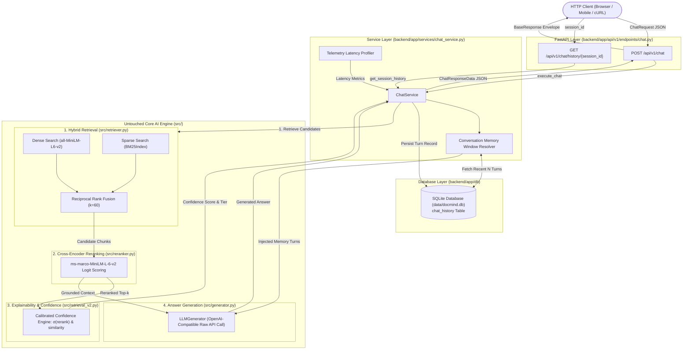
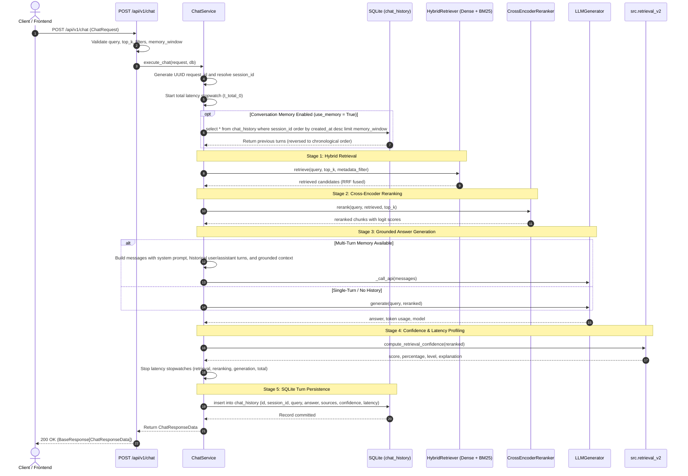

# DocMind AI — Backend Chat & RAG Architecture (Sprint 4.3)

## 1. Executive Summary

This architectural specification defines the design, data contracts, and execution workflows for **Sprint 4.3** of the **DocMind AI Backend**.

The objective of Sprint 4.3 is to expose the complete, state-of-the-art hybrid Retrieval-Augmented Generation (RAG) engine through production-grade FastAPI endpoints (`POST /api/v1/chat` and `GET /api/v1/chat/history/{session_id}`) while strictly preserving the mathematical and algorithmic integrity of the underlying AI engine ([`src/`](file:///Users/krishgupta/Downloads/Rag_From_Scratch-main/src)).

---

## 2. Architectural Principles & Guarantees

| Principle | Architectural Implementation | Benefit |
| :--- | :--- | :--- |
| **Algorithmic Invariance** | Zero modifications to [`src/retriever.py`](file:///Users/krishgupta/Downloads/Rag_From_Scratch-main/src/retriever.py), [`src/reranker.py`](file:///Users/krishgupta/Downloads/Rag_From_Scratch-main/src/reranker.py), or [`src/generator.py`](file:///Users/krishgupta/Downloads/Rag_From_Scratch-main/src/generator.py). | Preserves bit-for-bit mathematical equivalence with research benchmarks. |
| **Hybrid Persistence** | Tabular conversation turns stored in SQLite (`chat_history`); vector embeddings stored in NumPy/JSON VectorStore. | Eliminates database bloat; delivers microsecond cosine dot-product computations. |
| **Stateful Memory without Retrieval Pollution** | Recent conversation turns (default 3–5) are injected exclusively into the LLM chat completion prompt. | Prevents conversational drift from polluting sparse BM25 and dense vector queries. |
| **End-to-End Observability** | Every request receives a globally unique UUID `request_id`, component latency metrics, and confidence calibration. | Enables distributed tracing, performance profiling, and explainable AI audit trails. |
| **Loose Coupling & IoC** | Services (`ChatService`) depend on abstract providers via FastAPI Dependency Injection (`deps.py`). | 100% mockable in unit and integration tests without downloading weights or network calls. |

---

## 3. High-Level Component Architecture



---

## 4. End-to-End Chat & RAG Sequence Flow



---

## 5. Conversation Memory Design

### A. Sliding Window Mechanism
- Configured via `memory_window` (default: `3`, range: `1` to `10`).
- Fetches the last $N$ turns from the SQLite `chat_history` table:
  ```sql
  SELECT * FROM chat_history 
  WHERE session_id = :session_id 
  ORDER BY created_at DESC 
  LIMIT :memory_window;
  ```
- The descending rows are reversed in memory to ensure strictly chronological progression (`oldest -> newest`).

### B. Prompt Context Injection
The conversation memory turns are injected as native `user` and `assistant` role blocks directly preceding the current query:

```text
[System Message]
You are a precise question-answering assistant. Answer questions using ONLY the provided context...

[User Turn t-2]
Tell me about DocMind embeddings.

[Assistant Turn t-2]
DocMind AI uses sentence-transformers/all-MiniLM-L6-v2 to produce 384-dimensional embeddings [Source 1].

[User Turn t-1]
What reranker does it use?

[Assistant Turn t-1]
It uses an ms-marco-MiniLM-L-6-v2 cross-encoder to rerank candidate passages [Source 1].

[Current User Turn t]
Context:
[Source 1] (architecture.md, chunk 0):
DocMind AI fuses dense and sparse rankings using Reciprocal Rank Fusion...

Question: How does it combine them?
```

### C. Retrieval Isolation Guarantee
To preserve exact algorithmic determinism, previous conversation turns are **never appended to the search query** for BM25 or dense retrieval. Retrieval operates strictly on the active user query and specified metadata filters, completely eliminating semantic drift.

---

## 6. Telemetry & Confidence Formulas

### A. Mathematical Invariance of Confidence Scoring
Confidence is computed via [`src.retrieval_v2.compute_retrieval_confidence`](file:///Users/krishgupta/Downloads/Rag_From_Scratch-main/src/retrieval_v2.py):

1. **Reranker Probability**: Cross-encoder raw logit $s_{\text{rerank}}$ is mapped to probability interval $(0, 1)$ via logistic sigmoid:
   $$P_{\text{rerank}} = \sigma(s_{\text{rerank}}) = \frac{1}{1 + e^{-s_{\text{rerank}}}}$$
2. **Dense Similarity Probability**: Cosine similarity $s_{\text{sim}} \in [-1, 1]$ is bounded:
   $$P_{\text{sim}} = \max(0.0, \min(1.0, s_{\text{sim}}))$$
3. **Composite Weighted Confidence**:
   $$C = 0.70 \cdot P_{\text{rerank}} + 0.30 \cdot P_{\text{sim}}$$
4. **Calibrated Tiers**:
   - $C \ge 0.70 \implies \text{High Confidence}$ (Green `#10b981`)
   - $0.40 \le C < 0.70 \implies \text{Medium Confidence}$ (Amber `#f59e0b`)
   - $C < 0.40 \implies \text{Low Confidence}$ (Red `#ef4444`)

### B. Latency Telemetry Breakdown
The response includes high-resolution wall-clock measurements:
- `retrieval_latency_ms`: Dense dot-product search + BM25 tokenization + RRF fusion.
- `reranking_latency_ms`: Cross-encoder forward pass across candidate pairs.
- `generation_latency_ms`: Remote LLM HTTP API round-trip.
- `total_latency_ms`: End-to-end processing time including SQLite turn persistence.

---

## 7. Data Contracts & Schema Reference

### `ChatRequest`
```json
{
  "query": "string (min: 1, max: 4000)",
  "session_id": "string | null",
  "top_k": "integer (default: 5, min: 1, max: 50)",
  "filters": "object | null",
  "use_memory": "boolean (default: true)",
  "memory_window": "integer (default: 3, min: 1, max: 10)"
}
```

### `ChatResponseData`
```json
{
  "request_id": "string (UUID v4)",
  "session_id": "string",
  "query": "string",
  "answer": "string",
  "sources": [
    {
      "source_num": 1,
      "filename": "document.pdf",
      "chunk_index": 0,
      "score": 0.895421,
      "text": "Extracted text content...",
      "metadata": {}
    }
  ],
  "confidence": {
    "score": 0.8412,
    "percentage": 84.12,
    "level": "High",
    "color": "#10b981",
    "explanation": "Human-readable explanation..."
  },
  "metrics": {
    "retrieval_latency_ms": 14.25,
    "reranking_latency_ms": 8.12,
    "generation_latency_ms": 182.4,
    "total_latency_ms": 208.5,
    "retrieved_chunk_count": 6,
    "reranked_chunk_count": 3
  },
  "model": "openai/gpt-oss-120b",
  "created_at": "2026-10-28T05:00:00Z"
}
```

---

## 8. Integration Test Verification

The chat subsystem is verified by 7 integration tests in [`tests/test_backend_chat.py`](file:///Users/krishgupta/Downloads/Rag_From_Scratch-main/tests/test_backend_chat.py):

1. **`test_chat_endpoint_basic_query`**: Validates end-to-end execution, schema conformance, confidence calculation, latency metrics, and SQLite persistence.
2. **`test_chat_endpoint_empty_query_validation`**: Validates rejection of empty or whitespace-only queries with HTTP 422.
3. **`test_chat_endpoint_conversation_memory`**: Validates multi-turn context chaining across subsequent queries and chronological history retrieval via `GET /api/v1/chat/history/{session_id}`.
4. **`test_chat_endpoint_with_metadata_filters`**: Validates metadata filtering during hybrid candidate retrieval.
5. **`test_chat_endpoint_no_relevant_documents`**: Validates zero-chunk edge cases, verifying low confidence scores and informative fallback messages.
6. **`test_chat_endpoint_generator_fallback`**: Validates pipeline resilience when the LLM generator is offline or unconfigured.
7. **`test_chat_request_id_uniqueness`**: Validates that distinct UUIDs are generated for sequential requests.
