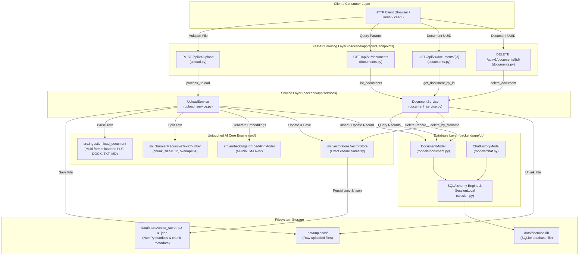
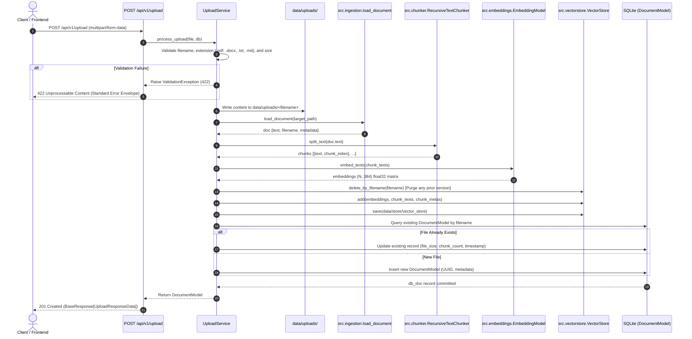
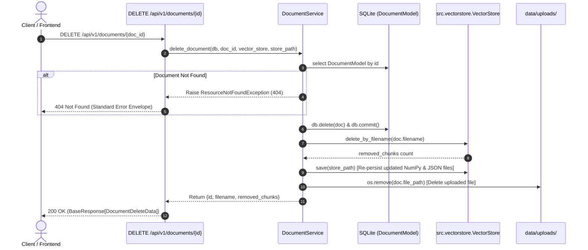

# DocMind AI — Backend Upload & Storage Architecture (Sprint 4.2)

## 1. Executive Summary

This specification defines the architectural design, data models, and service execution flows implemented in **Sprint 4.2** of the **DocMind AI Backend**.

The primary objective of Sprint 4.2 is to bridge the FastAPI backend infrastructure to the existing core AI engine ([`src/`](file:///Users/krishgupta/Downloads/Rag_From_Scratch-main/src)) while strictly honoring the following non-negotiable architectural constraints:
1. **Zero Modifications to AI Engine**: All retrieval, chunking, embedding, reranking, and generation algorithms in [`src/`](file:///Users/krishgupta/Downloads/Rag_From_Scratch-main/src) remain 100% mathematically and structurally unchanged.
2. **Hybrid Storage Segregation**:
   - **SQLite (via SQLAlchemy)**: Manages relational and tabular metadata (`documents` and `chat_history`).
   - **NumPy/JSON VectorStore**: Retains dense float32 vector matrices and chunk text mappings for microsecond-latency cosine similarity dot products.
3. **Decoupled Service Layer**: Encapsulates business logic in `UploadService` and `DocumentService`, accessible through FastAPI Dependency Injection (`deps.py`).

---

## 2. Hybrid Storage Segregation Rationale

```
+---------------------------------------------------------------------------------+
|                               DOCMIND AI STORAGE                                |
+---------------------------------------+-----------------------------------------+
|        SQLITE (Relational / ACID)     |       VECTORSTORE (Dense Indices)       |
+---------------------------------------+-----------------------------------------+
| Tables:                               | Files:                                  |
|   - documents (catalog & metadata)    |   - vector_store.npz (float32 matrix)   |
|   - chat_history (session turns)      |   - vector_store.json (chunk text & map)|
| Purpose:                              | Purpose:                                |
|   - Cataloging, audit logs            |   - Exact cosine similarity search      |
|   - Pagination, deletion lookups      |   - High-throughput dot-product math    |
|   - Zero BLOB/Vector storage overhead |   - In-memory NumPy cache               |
+---------------------------------------+-----------------------------------------+
```

### Architectural Justification
- **Relational Overhead Avoidance**: Storing large multidimensional embedding arrays (384-dim float32 vectors) inside SQLite BLOB or JSON columns creates severe I/O bottlenecks and serialization penalties during vector similarity searches.
- **Preserved Mathematical Equivalence**: By keeping the embeddings in [`src.vectorstore.VectorStore`](file:///Users/krishgupta/Downloads/Rag_From_Scratch-main/src/vectorstore.py), the hybrid retriever's dense cosine similarity search ($s_{\text{sim}} = \mathbf{e}_{\text{chunk}} \cdot \mathbf{e}_{\text{query}}$) remains bit-for-bit identical to the Streamlit UI and CLI pipelines.

---

## 3. SQLite Database Schema Specification

The database is initialized by default at `data/docmind.db` using SQLAlchemy 2.0 declarative models (`backend/app/db/models/`).

### A. `documents` Table
Stores high-level catalog metadata for every ingested document.

| Column | Type | Constraints | Description |
| :--- | :--- | :--- | :--- |
| `id` | `VARCHAR(36)` | Primary Key, Indexed | Unique UUID identifier for the document record |
| `filename` | `VARCHAR(255)` | Not Null, Indexed | Original sanitized filename (e.g. `annual_report.pdf`) |
| `file_type` | `VARCHAR(32)` | Not Null | File format extension (`pdf`, `docx`, `txt`, `md`) |
| `file_size` | `INTEGER` | Not Null | File size in bytes |
| `page_count` | `INTEGER` | Nullable | Extracted page count (for PDF / DOCX) |
| `chunk_count`| `INTEGER` | Not Null, Default `0` | Number of text chunks generated and stored in VectorStore |
| `upload_timestamp` | `DATETIME` | Not Null, UTC | ISO 8601 UTC timestamp of ingestion completion |
| `file_path` | `VARCHAR(1024)` | Not Null | Filesystem path on server (`data/uploads/<filename>`) |
| `status` | `VARCHAR(32)` | Not Null, Default `'indexed'` | Processing status (`indexed`, `processing`, `error`) |

### B. `chat_history` Table
Stores conversational interactions, user queries, answers, and retrieval metrics.

| Column | Type | Constraints | Description |
| :--- | :--- | :--- | :--- |
| `id` | `VARCHAR(36)` | Primary Key, Indexed | Unique UUID identifier for the chat turn |
| `session_id` | `VARCHAR(64)` | Not Null, Indexed | Session identifier for multi-turn conversation threads |
| `query` | `TEXT` | Not Null | Raw query string entered by the user |
| `answer` | `TEXT` | Not Null | LLM-generated answer grounded in retrieved chunks |
| `retrieved_sources` | `TEXT` | Nullable | JSON-serialized array of source citations and chunk scores |
| `confidence_score` | `FLOAT` | Nullable | Calibrated confidence score (0.0 to 1.0) |
| `latency_ms` | `FLOAT` | Nullable | Total wall-clock query-to-answer latency in ms |
| `created_at` | `DATETIME` | Not Null, UTC | UTC timestamp of the interaction |

---

## 4. Component Architecture & Layering



---

## 5. End-to-End Execution Workflows

### A. Document Upload & Ingestion Flow (`POST /api/v1/upload`)



---

### B. Document Deletion & Synchronization Flow (`DELETE /api/v1/documents/{id}`)



---

## 6. Error Handling & Validation Matrix

All API endpoints trap domain exceptions into a uniform JSON response envelope:

| Failure Mode | Detection Point | HTTP Code | Error Type | Returned Detail |
| :--- | :--- | :--- | :--- | :--- |
| **Unsupported Extension** | `UploadService` | `422` | `validation_error` | Lists attempted extension and allowed formats |
| **Empty File (0 bytes)** | `UploadService` | `422` | `validation_error` | Indicates file contains 0 bytes |
| **Oversized File (> 50MB)**| `UploadService` | `422` | `validation_error` | Reports size vs `MAX_UPLOAD_SIZE_BYTES` |
| **Non-Existent Document** | `DocumentService` | `404` | `resource_not_found` | Reports missing document UUID |
| **Ingestion Parse Failure**| `load_document` | `422` | `validation_error` | Reports format parsing error details |
| **Unhandled Server Error** | Global Exception Handler | `500` | `internal_server_error` | Logs server traceback; sanitizes response |

---

## 7. Integration Test Verification

The upload and document management foundation is backed by 11 integration tests in [`tests/test_backend_upload.py`](file:///Users/krishgupta/Downloads/Rag_From_Scratch-main/tests/test_backend_upload.py):

1. **`test_upload_txt_file_success`**: Validates uploading plain text files, chunk generation, VectorStore updates, and SQLite persistence.
2. **`test_upload_markdown_file_success`**: Validates markdown file structure retention and indexing.
3. **`test_upload_unsupported_extension_fails`**: Validates rejection of unauthorized file types (`.exe`).
4. **`test_upload_empty_file_fails`**: Validates rejection of 0-byte file uploads.
5. **`test_list_documents`**: Validates pagination and metadata listing from SQLite.
6. **`test_get_document_by_id`**: Validates single document record retrieval by UUID.
7. **`test_get_document_by_id_not_found`**: Validates 404 on non-existent document ID.
8. **`test_delete_document_success`**: Validates atomic removal from SQLite, VectorStore chunk purging, and disk file deletion.
9. **`test_delete_document_not_found`**: Validates 404 on deleting a non-existent document.
10. **`test_chat_history_table_model`**: Validates `chat_history` table persistence and column types.
11. **`test_reupload_same_filename_replaces`**: Validates idempotency and in-place vector index replacement upon uploading identical filenames.

---

## 8. Mathematical & Algorithmic Invariance Summary

No algorithms in [`src/`](file:///Users/krishgupta/Downloads/Rag_From_Scratch-main/src) were modified:
- **`RecursiveTextChunker`**: Tokenization boundaries and overlap mechanics remain identical.
- **`EmbeddingModel`**: Bi-encoder mean pooling and L2 normalization formulas remain identical.
- **`VectorStore`**: Dense cosine similarity via NumPy matrix multiplication ($\mathbf{A} \cdot \mathbf{b}$) remains identical.
- **`BM25` & `HybridRetriever`**: Reciprocal Rank Fusion ($k=60$) remains identical.
