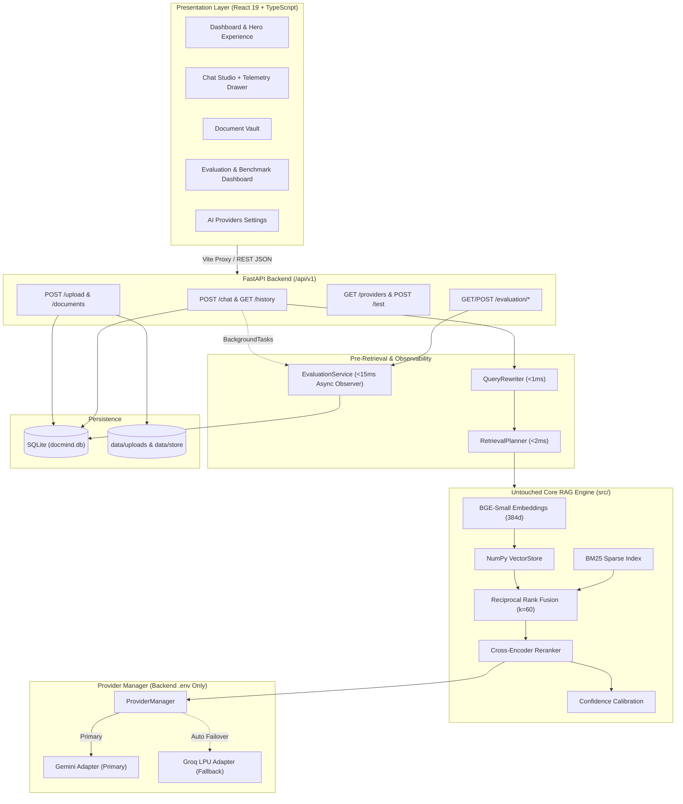
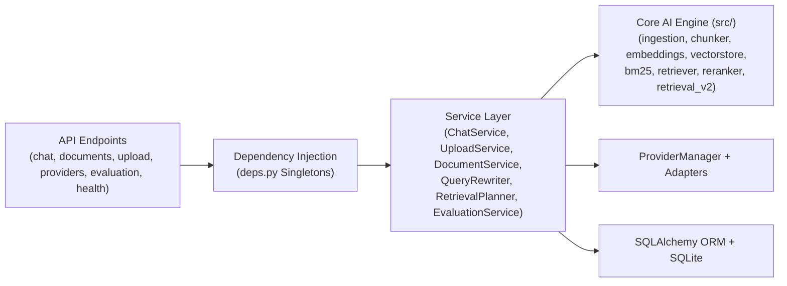
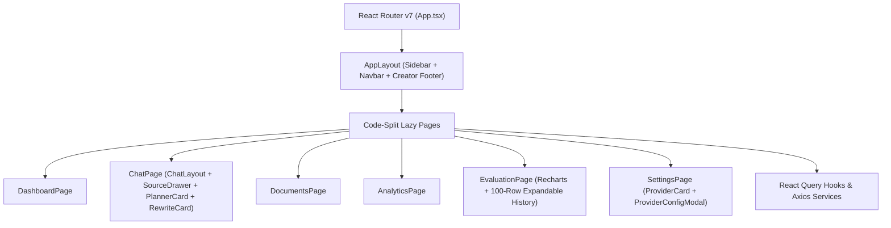
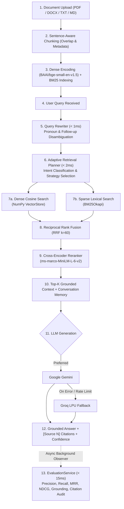
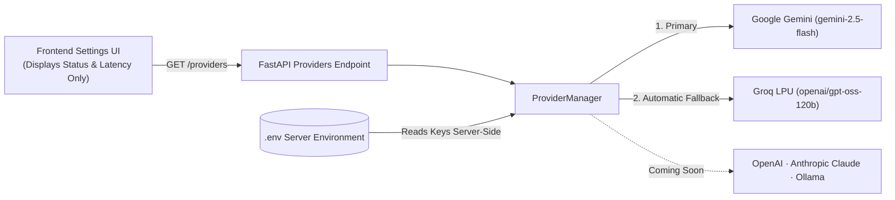

<div align="center">

<!-- Animated / Stylized Header Banner -->
<h1>DocMind AI</h1>

<p>
  <strong>Enterprise Hybrid Retrieval-Augmented Generation Platform for Intelligent Document Understanding</strong>
</p>

<p>
  Built from first principles with Dense Semantic Search, Sparse BM25 Indexing, Reciprocal Rank Fusion (RRF),<br />
  Cross-Encoder Neural Reranking, Adaptive Retrieval Planning, Multi-Provider LLM Failover, and Continuous RAG Evaluation.
</p>

<br />

<!-- Technology & Status Badges -->
<p>
  
  
  
  
  
  
</p>
<p>
  
  
  
  
  
</p>

<p>
  <a href="#-project-overview">Overview</a> •
  <a href="#-system-architecture">Architecture</a> •
  <a href="#-retrieval-pipeline">Pipeline</a> •
  <a href="#-api-documentation">API Docs</a> •
  <a href="#-installation--quick-start">Quick Start</a> •
  <a href="#-evaluation-framework">Evaluation</a> •
  <a href="#-author">Author</a>
</p>

</div>

---

## 📖 Project Overview

**DocMind AI** is a production-grade, full-stack Retrieval-Augmented Generation (RAG) platform engineered without black-box orchestration frameworks. Every stage of the information retrieval and answer generation lifecycle—from binary document parsing and overlapping sentence chunking to dense vector indexing, sparse lexical scoring, rank fusion, neural cross-encoder reranking, and automated faithfulness auditing—is implemented transparently and modularly.

Unlike naive vector-only chatbots that fail on exact identifiers, acronyms, or multi-turn follow-ups, DocMind AI orchestrates an **8-stage deterministic + neural pipeline**:

- **Query Rewriting** (`< 1 ms`): Resolves conversational pronouns (`it`, `this`, `that`, `they`) and incomplete follow-up fragments against session memory before retrieval.
- **Adaptive Retrieval Planning** (`< 2 ms`): Classifies query intent (`fact_lookup`, `summary`, `comparison`, `list`, `follow_up`, `code`, `multi_document`) and dynamically tunes `top_k`, rerank depth, memory activation, and document coverage.
- **Dense Semantic Retrieval**: Encodes text into 384-dimensional L2-normalized embeddings (`BAAI/bge-small-en-v1.5`) stored in a persisted NumPy cosine vector store.
- **Sparse BM25 Retrieval**: Tokenizes and scores exact lexical matches using a tuned BM25Okapi index ($k_1 = 1.5, b = 0.75$).
- **Reciprocal Rank Fusion (RRF)**: Unifies dense and sparse ranked candidate pools with smoothing constant $k = 60$, eliminating cross-model score calibration drift.
- **Cross-Encoder Neural Reranking**: Re-scores fused candidates via token-level query-passage attention (`cross-encoder/ms-marco-MiniLM-L-6-v2`).
- **Multi-LLM Support with Automatic Failover**: Executes grounded generation on **Google Gemini** first and seamlessly cascades to **Groq LPU** (`openai/gpt-oss-120b`) on rate limits, timeouts, or model errors.
- **Continuous Evaluation & Benchmarking**: Observes every completed chat turn asynchronously (`< 15 ms` overhead) to measure Precision@K, Recall@K, MRR, NDCG, Grounding, Faithfulness, Citation Integrity, and Hallucination Risk.

Every answer is strictly grounded in retrieved document context with `[Source N]` inline citations, calibrated retrieval confidence tiers, and explainable telemetry.

---

## ✨ Project Highlights

- ✓ **Hybrid Retrieval**: Simultaneous dense semantic embeddings + sparse BM25 lexical search fused with RRF ($k = 60$).
- ✓ **Enterprise Architecture**: Clean layered separation across Presentation (React), API/Service Layer (FastAPI), Provider Manager, and Core AI Engine (`src/`).
- ✓ **FastAPI Backend**: Async-ready REST API with lifespan management, structured Pydantic schemas, and OpenAPI/Swagger documentation.
- ✓ **React + TypeScript**: Strictly typed React 19 SPA powered by Vite 8, React Query, Framer Motion, and Recharts 3.
- ✓ **Glassmorphism UI**: Jet Black (`#0A0A0A`), Cerulean Blue (`#007BA7`), and Neon Rose (`#FF2D95`) design system inspired by Linear, Vercel, and Apple.
- ✓ **Multi-Provider LLM**: Adapter-based `ProviderManager` with pluggable adapters for Gemini, Groq, and upcoming OpenAI, Anthropic Claude, and Ollama.
- ✓ **Automatic Provider Fallback**: Zero-downtime failover from Google Gemini to Groq LPU without user intervention.
- ✓ **Query Rewrite**: Conservative pre-retrieval disambiguation for pronouns, follow-ups, and missing subjects.
- ✓ **Adaptive Retrieval Planner**: Perplexity-style intent classification dynamically adjusting retrieval breadth and rerank depth.
- ✓ **Cross-Encoder Reranking**: Deep semantic pair scoring via `ms-marco-MiniLM-L-6-v2`.
- ✓ **Confidence Scoring**: Calibrated multi-signal confidence engine combining normalized cross-encoder logits (70%) and dense similarity (30%).
- ✓ **Source Attribution**: Clickable `[Source N]` pills linked to exact filenames, chunk indices, and highlighted passages in the inspection drawer.
- ✓ **Evaluation Framework**: Independent post-response observer, 55-query automated benchmark suite, and CSV/JSON/PDF report exports.
- ✓ **Production Ready**: 222+ passing unit and integration tests, backend-only credential isolation, and Docker/Render/Vercel deployment support.

---

## 📑 Table of Contents

- [Project Overview](#-project-overview)
- [Project Highlights](#-project-highlights)
- [Features](#-features)
- [Tech Stack](#-tech-stack)
- [System Architecture](#-system-architecture)
- [Retrieval Pipeline](#-retrieval-pipeline)
- [Project Structure](#-project-structure)
- [Core Modules](#-core-modules)
- [AI & Retrieval Architecture](#-ai--retrieval-architecture)
- [Provider Management & Security](#-provider-management--security)
- [Evaluation Framework](#-evaluation-framework)
- [Screenshots](#-screenshots)
- [Installation & Quick Start](#-installation--quick-start)
- [Environment Variables](#-environment-variables)
- [API Documentation](#-api-documentation)
- [Example Requests](#-example-requests)
- [Performance Benchmarks](#-performance-benchmarks)
- [Testing](#-testing)
- [Deployment](#-deployment)
- [Roadmap](#-roadmap)
- [Contributing](#-contributing)
- [License](#-license)
- [Author](#-author)
- [Acknowledgements](#-acknowledgements)

---

## 🚀 Features

| Category | Feature | Description |
| :--- | :--- | :--- |
| **Retrieval** | **Hybrid Search** | Executes dense semantic search and sparse BM25 keyword search in parallel, over-fetching $3\times \text{top\_k}$ candidates before fusion. |
| **Retrieval** | **Vector Search** | 384-dimensional L2-normalized embeddings (`BAAI/bge-small-en-v1.5`) persisted as `.npz` + `.json` for instant warm reload. |
| **Retrieval** | **BM25 Sparse Index** | Custom zero-dependency BM25Okapi scorer ($k_1=1.5, b=0.75$) for exact acronyms, formulas, error codes, and proper nouns. |
| **Retrieval** | **Reciprocal Rank Fusion** | Rank-based fusion formula $\sum \frac{1}{60 + \text{rank}}$ invariant to incompatible score distributions. |
| **Reranking** | **Cross-Encoder** | `cross-encoder/ms-marco-MiniLM-L-6-v2` scores `(query, chunk)` pairs jointly for high-precision top-$K$ ordering. |
| **Ingestion** | **Document Upload** | Drag-and-drop and REST upload supporting **PDF**, **DOCX**, **TXT**, and **Markdown** up to 50 MB with metadata extraction. |
| **Orchestration** | **Query Rewrite** | Isolated `< 1 ms` pre-retrieval layer resolving pronouns, aspect fragments, and multi-turn ellipsis conservatively. |
| **Orchestration** | **Adaptive Planner** | `< 2 ms` query classifier (`fact_lookup`, `summary`, `comparison`, `list`, `follow_up`, `code`, `multi_document`) tuning retrieval parameters. |
| **Memory** | **Conversation Memory** | Session-scoped SQLite `chat_history` windowing maintaining coherent multi-turn dialogue context. |
| **Explainability** | **Confidence & Citations** | Calibrated `High`/`Medium`/`Low` confidence tiering and interactive `[Source N]` chunk attribution drawer. |
| **Observability** | **Telemetry & Analytics** | Stage-by-stage latency tracking (Rewrite, Planner, Retrieval, Rerank, Generation, Eval) and Recharts analytics dashboards. |
| **LLM Ops** | **Provider Management** | Server-side `.env` credential management, live ping latency testing, and automatic Gemini $\rightarrow$ Groq fallback. |
| **Quality** | **Evaluation Suite** | Automated Precision@K, Recall@K, MRR, NDCG, Grounding, Faithfulness, Citation Verification, 55-query benchmarks, and CSV/JSON/PDF exports. |
| **Operations** | **Deployment Ready** | Containerized `Dockerfile`, CORS configuration, health checks, and Vercel + Render deployment blueprints. |

---

## 🛠 Tech Stack

| Layer | Technology | Role |
| :--- | :--- | :--- |
| **Frontend** | React 19, TypeScript, Vite 8, Tailwind CSS 3.4 | Single-page application, glassmorphic dark UI, responsive workspace |
| **State & Routing** | TanStack React Query 5, React Router 7, Axios | Server-state caching, optimistic chat updates, API proxy integration |
| **Charts & Visuals** | Recharts 3, Framer Motion 14, Lucide React | Line/Area/Bar/Pie charts, quality heatmaps, motion transitions, iconography |
| **Backend API** | Python 3.11+, FastAPI, Pydantic v2, Uvicorn | Async REST endpoints, schema validation, OpenAPI docs, background tasks |
| **Embedding Model** | `BAAI/bge-small-en-v1.5` (384d, PyTorch + Transformers) | Dense semantic vector encoding for queries and document chunks |
| **Cross-Encoder** | `cross-encoder/ms-marco-MiniLM-L-6-v2` | Joint query-passage relevance scoring and candidate reranking |
| **LLM Providers** | Google Gemini (`gemini-2.5-flash`), Groq (`openai/gpt-oss-120b`) | Primary grounded generation with ultra-fast LPU automatic fallback |
| **Database** | SQLite + SQLAlchemy 2.0 ORM | Persistent `documents`, `chat_history`, `provider_configs`, and `evaluation_history` |
| **Vector & File Storage** | NumPy `.npz` + JSON metadata + Local Disk (`data/uploads`) | Lightweight, portable dense index and uploaded source document store |
| **Reporting & Export** | Matplotlib (`Agg` PDF backend), Python `csv` / `json` | Multi-page PDF reports with embedded charts, structured JSON, and CSV exports |
| **Deployment** | Docker, Vercel (Frontend), Render (Backend) | Production containerization and cloud hosting |

---

## 🏗 System Architecture

### Complete System Architecture



### Backend Layered Architecture



### Frontend Architecture



---

## 🔄 Retrieval & Chat Pipeline



---

## 📁 Project Structure

```text
Rag_From_Scratch-main/
├── app.py                              # Legacy Streamlit entry point
├── Dockerfile                          # Production backend container specification
├── requirements.txt                    # Core Python AI/ML dependencies
├── .env                                # Server-side environment configuration (never committed with secrets)
├── ARCHITECTURE.md                     # Core system architecture notes
├── EVALUATION_FRAMEWORK.md             # Sprint 6.0 evaluation & benchmarking specification
├── CHANGELOG.md                        # Versioned release history (v1.0.0 → v1.7.0)
│
├── src/                                # Core Pure-Python RAG Engine (framework-free)
│   ├── ingestion.py                    # PDF, DOCX, TXT, and Markdown loaders with metadata
│   ├── chunker.py                      # Token/sentence-aware overlapping chunker
│   ├── embeddings.py                   # BAAI/bge-small-en-v1.5 encoder wrapper
│   ├── vectorstore.py                  # NumPy L2 cosine store with .npz/.json persistence
│   ├── bm25.py                         # Tuned BM25Okapi sparse lexical retriever
│   ├── retriever.py                    # HybridRetriever implementing RRF (k=60)
│   ├── reranker.py                     # CrossEncoderReranker (ms-marco-MiniLM-L-6-v2)
│   ├── retrieval_v2.py                 # Confidence calibration & metadata filtering
│   ├── generator.py                    # Grounded prompt builder & citation formatter
│   ├── evaluation.py                   # Base IR evaluation primitives
│   └── utils.py                        # Tokenization, path normalization, helpers
│
├── backend/                            # FastAPI Enterprise Backend
│   └── app/
│       ├── main.py                     # FastAPI app factory, CORS, lifespan & DB init
│       ├── core/                       # Config (Pydantic Settings), structured logging, error handlers
│       ├── db/                         # SQLite engine, session factory, ORM models
│       │   └── models/
│       │       ├── chat.py             # chat_history table
│       │       ├── document.py         # documents table
│       │       ├── evaluation.py       # evaluation_history table
│       │       └── provider_config.py  # provider_configs table
│       ├── schemas/                    # Pydantic v2 request/response data contracts
│       ├── api/
│       │   ├── deps.py                 # Singleton DI providers (VectorStore, Embedder, Reranker, etc.)
│       │   └── v1/
│       │       ├── api.py              # v1 router aggregation
│       │       └── endpoints/          # chat, documents, upload, providers, evaluation, health
│       └── services/                   # Business & AI orchestration services
│           ├── chat_service.py         # End-to-end RAG pipeline coordinator
│           ├── upload_service.py       # Ingestion, chunking, indexing & SQLite sync
│           ├── document_service.py     # Corpus listing, deletion & vector cleanup
│           ├── query_rewriter.py       # Pre-retrieval pronoun & follow-up optimizer
│           ├── retrieval_planner.py    # Adaptive 7-strategy intent planner
│           ├── evaluation_service.py   # Continuous evaluation, benchmark runner & PDF/CSV/JSON export
│           └── llm/                    # ProviderManager + Gemini/Groq/OpenAI/Anthropic/Ollama adapters
│
├── frontend/                           # React 19 + TypeScript + Vite SPA
│   ├── package.json                    # Frontend dependencies & build scripts
│   ├── vite.config.ts                  # Vite dev server & /api reverse proxy to 127.0.0.1:8000
│   └── src/
│       ├── App.tsx                     # Code-split router configuration
│       ├── layout/                     # AppLayout, Collapsible Sidebar, Navbar
│       ├── pages/                      # DashboardPage, ChatPage, DocumentsPage, AnalyticsPage, EvaluationPage, SettingsPage
│       ├── components/                 # Chat, Dashboard, Settings & common UI primitives
│       ├── hooks/                      # React Query hooks (useChatWorkspace, useDocuments, useHealth, etc.)
│       ├── services/                   # Typed Axios API clients
│       └── types/                      # TypeScript interfaces mirroring backend Pydantic schemas
│
├── evaluation/                         # Ground-Truth Benchmarking Assets
│   └── datasets/
│       ├── sample_questions.json       # 55 curated domain & architecture benchmark queries
│       ├── expected_answers.json       # Reference ground-truth answers
│       └── benchmark_config.json       # Quality thresholds and latency budgets
│
├── data/                               # Runtime SQLite DB, uploaded files & persisted vector store
└── tests/                              # Comprehensive pytest suite (222+ passing tests)
```

---

## 🧩 Core Modules

| Module | Responsibility |
| :--- | :--- |
| **Frontend (`frontend/src/`)** | Interactive workspace with immersive Hero, Chat Studio with live telemetry drawer, Document Vault, Recharts Analytics, Evaluation Dashboard, and Settings UI. |
| **Backend (`backend/app/`)** | FastAPI REST gateway with strict Pydantic validation, dependency-injected AI singletons, and SQLite persistence. |
| **Core AI Engine (`src/`)** | Framework-free mathematical implementation of chunking, dense embeddings, NumPy vector search, BM25, RRF, Cross-Encoder reranking, and confidence calibration. |
| **Upload Service** | Validates file extension/size, extracts text per page/paragraph, chunks with overlap, encodes dense vectors, rebuilds BM25, and persists metadata to SQLite and disk. |
| **Document Service** | Manages corpus metadata queries and atomic deletion across SQLite, VectorStore chunks, BM25 index, and uploaded source files. |
| **Chat Service** | Orchestrates memory retrieval, Query Rewrite, Adaptive Retrieval Planning, Hybrid Retrieval, Cross-Encoder reranking, ProviderManager generation, and turn persistence. |
| **Query Rewriter** | Conservative heuristic disambiguator resolving pronouns (`it`, `this`, `that`, `they`) and elliptical follow-ups in `< 1 ms`. |
| **Retrieval Planner** | Classifies query intent into 7 strategies (`fact_lookup`, `summary`, `comparison`, `list`, `follow_up`, `code`, `multi_document`) in `< 2 ms`. |
| **Provider Manager** | Abstracts LLM inference behind `BaseLLMAdapter`, reading `.env` keys server-side and executing Gemini $\rightarrow$ Groq automatic fallback. |
| **Evaluation Service** | Post-chat async observer computing IR metrics, 0–100 generation scores, citation verification, 55-query benchmarks, and CSV/JSON/PDF report exports. |

---

## 🧠 AI & Retrieval Architecture

### 1. Dense Semantic Retrieval
Queries and chunks are embedded using **`BAAI/bge-small-en-v1.5`** (384 dimensions) and normalized to unit L2 length so inner product equals exact cosine similarity:
$$\text{sim}(q, d) = \frac{E(q) \cdot E(d)}{\|E(q)\|_2 \|E(d)\|_2}$$

### 2. Sparse Lexical Retrieval (BM25)
Exact keyword, identifier, and acronym matching is computed using BM25Okapi ($k_1 = 1.5$, $b = 0.75$):
$$\text{BM25}(q, d) = \sum_{t \in q} \text{IDF}(t) \cdot \frac{f(t, d) \cdot (k_1 + 1)}{f(t, d) + k_1 \cdot \left(1 - b + b \cdot \frac{|d|}{\text{avgdl}}\right)}$$

### 3. Reciprocal Rank Fusion (RRF)
Dense and sparse candidate rankings ($3\times \text{top\_k}$ each) are combined without score-scale bias using $k = 60$:
$$\text{RRF}(d) = \frac{1}{60 + \text{rank}_{\text{dense}}(d)} + \frac{1}{60 + \text{rank}_{\text{bm25}}(d)}$$

### 4. Cross-Encoder Reranking & Confidence Calibration
Top fused candidates are jointly scored by **`cross-encoder/ms-marco-MiniLM-L-6-v2`**. The **Confidence Engine** calibrates a $[0, 100\%]$ reliability score combining normalized cross-encoder logits (weight $0.70$) and top dense cosine similarity (weight $0.30$).

### 5. Query Rewriting & Adaptive Retrieval Planning
- **Query Rewriter**: Transforms `"Explain it simply"` (after `"What is Perceptron?"`) into `"Explain Perceptron simply."` or `"Compare with SVM"` into `"Compare Random Forest with SVM."` in $< 1\text{ ms}$.
- **Adaptive Retrieval Planner**: Routes queries to tailored retrieval budgets:
  - `fact_lookup` (`top_k=5, rerank=3`)
  - `comparison` (`top_k=10, rerank=5`)
  - `summary` (`top_k=12, rerank=6`)
  - `list` (`top_k=15, rerank=7`)
  - `follow_up` (`needs_memory=True`, reuses rewritten query)
  - `code` (prioritizes Markdown & code-bearing chunks)
  - `multi_document` (ensures balanced retrieval across every uploaded file)

---

## 🔐 Provider Management & Security

DocMind AI enforces strict **backend-only credential isolation**:



- **Zero Frontend Secret Exposure**: API keys are loaded exclusively from backend `.env` via Pydantic `Settings`. REST endpoints return only connection status (`Connected` / `Not Configured` / `Coming Soon`), active model, credential source (`Backend (.env)`), and ping latency.
- **Automatic Fallback**: If Google Gemini encounters quota limits, deprecation errors, or network timeouts, `ProviderManager` automatically falls back to Groq LPU inference without breaking the user session.
- **Input & Upload Hardening**: Strict Pydantic v2 validation on all requests, 50 MB upload cap, and extension allowlisting (`.pdf`, `.docx`, `.txt`, `.md`).

---

## 📊 Evaluation Framework

DocMind AI includes an independent **Enterprise RAG Evaluation & Benchmarking System** (`EVALUATION_FRAMEWORK.md`):

- **Automatic Post-Chat Auditing**: Triggered asynchronously via FastAPI `BackgroundTasks` (`< 15 ms` overhead) and persisted to SQLite (`evaluation_history`).
- **Retrieval Metrics**: `Precision@K`, `Recall@K`, `MRR`, `DCG`, `IDCG`, `NDCG`, `Context Recall`, `Retrieval Coverage`, `Source Diversity`.
- **Generation Quality ($0 \rightarrow 100$)**: `Grounding Score`, `Faithfulness`, `Citation Coverage`, `Context Utilization`, `Answer Completeness`, `Hallucination Risk`, `Source Utilization`, `Answer Length`, `Reasoning Coverage`.
- **Non-Destructive Citation Audit**: Verifies every `[Source N]` reference against returned chunk metadata and text without altering generated answers.
- **Automated 55-Query Benchmark**: Evaluates `evaluation/datasets/sample_questions.json` via `POST /api/v1/evaluation/run`.
- **Multi-Format Exports**: Download Executive Summary, metrics, charts, and evaluation tables in **CSV**, **JSON**, or **PDF**.

---

## 📸 Screenshots

> _Replace the placeholders below with captured screenshots from your local instance (`http://localhost:5173`)._

| View | Preview Placeholder |
| :--- | :--- |
| **Dashboard Overview** | `` — *Immersive Hero experience, live engine status, and corpus overview.* |
| **Chat Studio** | `` — *Multi-turn RAG chat with `[Source N]` citations, Query Optimized badge, Retrieval Planner card, and Confidence drawer.* |
| **Document Vault** | `` — *Drag-and-drop PDF/DOCX/TXT/Markdown ingestion with chunk counts and index status.* |
| **Analytics & Telemetry** | `` — *Recharts latency breakdowns, query trends, and 6-service infrastructure health monitor.* |
| **AI Providers Settings** | `` — *Backend `.env` provider cards for Gemini (Default), Groq (Fallback), and Coming Soon adapters.* |
| **Evaluation Dashboard** | `` — *Overall RAG Score, Retrieval/Generation matrices, Heatmap, 55-query benchmark runner, and expandable 100-row history.* |

---

## 💻 Installation & Quick Start

### Prerequisites
- **Python**: `3.11+`
- **Node.js**: `18+` (with `npm`)
- **API Keys**: A Google Gemini API key and/or Groq API key

### 1. Clone the Repository

```bash
git clone https://github.com/your-username/docmind-ai.git
cd docmind-ai
```

### 2. Create & Activate Python Virtual Environment

```bash
python -m venv .venv
source .venv/bin/activate        # macOS / Linux
# .venv\Scripts\activate         # Windows
```

### 3. Install Backend Dependencies

```bash
pip install -r requirements.txt
pip install fastapi uvicorn sqlalchemy pydantic-settings python-multipart python-docx sentence-transformers matplotlib
```

### 4. Configure Environment Variables

Create a root `.env` file (see [Environment Variables](#-environment-variables) below) and add your `GEMINI_API_KEY` and/or `GROQ_API_KEY`.

### 5. Install Frontend Dependencies

```bash
cd frontend
npm install
cd ..
```

### 6. Run Backend Server (Port 8000)

```bash
python -m uvicorn backend.app.main:app --host 0.0.0.0 --port 8000 --reload
```

### 7. Run Frontend Dev Server (Port 5173)

```bash
npm --prefix frontend run dev -- --host 0.0.0.0 --port 5173
```

### 8. Open in Browser

Navigate to **[http://localhost:5173](http://localhost:5173)** (or **[http://localhost:8000/docs](http://localhost:8000/docs)** for interactive Swagger API docs).

---

## ⚙️ Environment Variables

Create a `.env` file in the project root. **Never commit real API keys to version control.**

```dotenv
# ------------------------
# APPLICATION
# ------------------------
APP_NAME=DocMind AI
APP_ENV=development
DEBUG=True

# ------------------------
# DEFAULT PROVIDER & FALLBACK
# ------------------------
DEFAULT_PROVIDER=gemini
DEFAULT_MODEL=gemini-2.5-flash

# ------------------------
# GEMINI (PRIMARY)
# ------------------------
GEMINI_API_KEY=

# ------------------------
# GROQ (AUTOMATIC FALLBACK)
# ------------------------
GROQ_API_KEY=
GROQ_MODEL=openai/gpt-oss-120b

# ------------------------
# EMBEDDINGS & RERANKER
# ------------------------
EMBEDDING_MODEL=BAAI/bge-small-en-v1.5
RERANK_MODEL=cross-encoder/ms-marco-MiniLM-L-6-v2

# ------------------------
# RETRIEVAL & ORCHESTRATION
# ------------------------
TOP_K=8
RRF_K=60
SIMILARITY_THRESHOLD=0.25
ENABLE_QUERY_REWRITE=true
ENABLE_RETRIEVAL_PLANNER=true

# ------------------------
# DATABASE & STORAGE
# ------------------------
DATABASE_URL=sqlite:///./data/docmind.db
VECTOR_PATH=data/vector_store
UPLOAD_FOLDER=data/uploads
MAX_FILE_SIZE_MB=50
```

---

## 📡 API Documentation

All endpoints are served under `/api/v1` and return a standardized `BaseResponse` envelope (`success`, `message`, `data`).

| Group | Method | Endpoint | Description |
| :--- | :--- | :--- | :--- |
| **System** | `GET` | `/api/v1/health` | Returns backend health, API status, AI engine readiness, and storage state. |
| **Upload** | `POST` | `/api/v1/documents/upload` | Multipart file upload (`.pdf`, `.docx`, `.txt`, `.md`), chunking, embedding, and indexing. |
| **Documents** | `GET` | `/api/v1/documents` | Lists all indexed documents with chunk counts, file size, and upload timestamps. |
| **Documents** | `DELETE` | `/api/v1/documents/{document_id}` | Atomically removes document record, vector chunks, BM25 entries, and source file. |
| **Chat & RAG** | `POST` | `/api/v1/chat` | Executes Query Rewrite $\rightarrow$ Retrieval Planner $\rightarrow$ Hybrid RAG $\rightarrow$ Rerank $\rightarrow$ LLM $\rightarrow$ Async Eval. |
| **Chat & RAG** | `GET` | `/api/v1/chat/history/{session_id}` | Retrieves chronological conversation turns for a session ID. |
| **Providers** | `GET` | `/api/v1/providers` | Returns provider statuses (`Connected`, `Not Configured`, `Coming Soon`) without exposing keys. |
| **Providers** | `POST` | `/api/v1/providers/{provider_id}/test` | Pings the provider using `.env` credentials and returns connection status + latency. |
| **Evaluation** | `GET` | `/api/v1/evaluation/latest` | Returns the most recent persisted evaluation report. |
| **Evaluation** | `GET` | `/api/v1/evaluation/history` | Returns up to the last 100 evaluations from `evaluation_history`. |
| **Evaluation** | `GET` | `/api/v1/evaluation/summary` | Returns aggregated dashboard KPIs, trends, provider comparison, and heatmap matrix. |
| **Evaluation** | `POST` | `/api/v1/evaluation/run` | Runs automated ground-truth benchmark (55+ queries) from `evaluation/datasets/`. |
| **Evaluation** | `GET` | `/api/v1/evaluation/export` | Downloads full evaluation report in `csv`, `json`, or `pdf` format. |

---

## 🧪 Example Requests

### Health Check
```bash
curl -s http://localhost:8000/api/v1/health
```

### Upload a Document
```bash
curl -s -X POST http://localhost:8000/api/v1/documents/upload \
  -F "file=@./data/benchmark_corpus.txt"
```

### Ask a Grounded Question
```bash
curl -s -X POST http://localhost:8000/api/v1/chat \
  -H "Content-Type: application/json" \
  -d '{
    "query": "How does DocMind AI combine dense and sparse retrieval?",
    "session_id": "demo_session_01",
    "top_k": 5,
    "use_memory": true
  }'
```

### Test AI Provider Connection
```bash
curl -s -X POST http://localhost:8000/api/v1/providers/groq/test
```

### Run 55-Query Evaluation Benchmark & Export PDF Report
```bash
curl -s -X POST http://localhost:8000/api/v1/evaluation/run \
  -H "Content-Type: application/json" \
  -d '{"dataset_name": "sample_questions.json", "max_queries": 55}'

curl -L "http://localhost:8000/api/v1/evaluation/export?format=pdf" -o evaluation_report.pdf
```

---

## ⚡ Performance Benchmarks

Measured across local Apple Silicon / CPU inference with `BAAI/bge-small-en-v1.5`, `ms-marco-MiniLM-L-6-v2`, and Groq LPU (`openai/gpt-oss-120b`) fallback:

| Pipeline Stage | Typical Latency | Overhead Budget | Notes |
| :--- | :---: | :---: | :--- |
| **Query Rewriter** | `0.3 – 0.8 ms` | `< 50 ms` | Pure in-memory regex & context extraction |
| **Adaptive Retrieval Planner** | `0.1 – 0.4 ms` | `< 2 ms` | Pre-compiled intent classifier |
| **Average Retrieval (Dense + BM25 + RRF)** | `45 – 180 ms` | `< 250 ms` | Scales with corpus chunk count |
| **Average Reranking (Cross-Encoder)** | `25 – 120 ms` | `< 200 ms` | Top candidate pair scoring |
| **Average Generation (LLM)** | `500 – 1,400 ms` | Provider-bound | Fast LPU / Flash inference |
| **Post-Chat Evaluation Observer** | `0.7 – 3.5 ms` | `< 15 ms` | Non-blocking background task |
| **Average Total Response Time** | **~0.9 – 1.6 s** | — | End-to-end grounded response with citations |

---

## 🧪 Testing

The repository includes **222 passing automated tests** covering core IR math, chunking, ingestion, backend endpoints, provider failover, query rewriting, adaptive planning, and evaluation:

```bash
# Run full backend & core RAG test suite
pytest tests/ -v

# Run Sprint 6.0 Evaluation Framework tests
pytest tests/test_evaluation_framework.py -v

# Verify Frontend TypeScript & Vite production build
npm --prefix frontend run build
```

| Suite | Coverage | Status |
| :--- | :--- | :---: |
| **Core Engine (`tests/test_*.py`)** | Embeddings, VectorStore, BM25, Chunker, Ingestion, Retriever, Reranker, Generator | ✅ Passing |
| **Backend APIs (`tests/test_backend_*.py`)** | Health, Upload, Documents, Chat, Memory, Filters, Providers | ✅ Passing |
| **Orchestration (`test_query_rewriter.py`, `test_retrieval_planner.py`)** | Pronoun resolution, follow-ups, 7 planner strategies, latency bounds, fallbacks | ✅ Passing |
| **Evaluation (`test_evaluation_framework.py`)** | Precision/Recall/MRR/NDCG, Grounding, Citations, 55-query Benchmark, CSV/JSON/PDF | ✅ Passing |
| **Frontend (`npm run build`)** | Strict TypeScript compilation (`tsc -b`) + Vite bundling | ✅ 0 Errors |

---

## 🚀 Deployment

### Frontend (Vercel)
1. Import the repository into **Vercel** and set the **Root Directory** to `frontend`.
2. Build Command: `npm run build` · Output Directory: `dist`.
3. Configure `VITE_API_BASE_URL` pointing to your deployed backend `/api/v1` URL.

### Backend (Render / Docker)
1. Deploy using the included `Dockerfile` or a Python Web Service on **Render**.
2. Start Command:
   ```bash
   uvicorn backend.app.main:app --host 0.0.0.0 --port $PORT
   ```
3. Add `GEMINI_API_KEY`, `GROQ_API_KEY`, and `CORS_ORIGINS` in the Render environment dashboard.

---

## 🗺 Project Roadmap

### Completed
- [x] Core Hybrid Retrieval Engine (Dense BGE + BM25 + RRF $k=60$)
- [x] Cross-Encoder Neural Reranking (`ms-marco-MiniLM-L-6-v2`) & Calibrated Confidence Engine
- [x] FastAPI Backend + SQLite Persistence (`documents`, `chat_history`, `evaluation_history`)
- [x] Premium React 19 + TypeScript Glassmorphic UI
- [x] Query Rewrite Layer (`< 1 ms` pronoun & follow-up disambiguation)
- [x] Adaptive Retrieval Planner (`< 2 ms`, 7 intent-aware strategies)
- [x] Multi-Provider Manager with Gemini Primary & Groq Automatic Fallback
- [x] Enterprise Evaluation Framework, 55-Query Benchmark & CSV/JSON/PDF Reporting

### Planned
- [ ] **Semantic Response Cache** — Embedding-similarity caching for recurring enterprise queries
- [ ] **OCR Pipeline** — Tesseract / PaddleOCR extraction for scanned PDFs and diagrams
- [ ] **Multimodal Vision RAG** — Native table, chart, and image embedding retrieval
- [ ] **Authentication & RBAC** — JWT / OAuth2 multi-tenant workspaces and document ACLs
- [ ] **Cloud Object & Vector Storage** — Optional S3/GCS document buckets and pgvector/Qdrant adapters

---

## 🤝 Contributing

Contributions are welcome! To propose a feature or bug fix:

1. **Fork** the repository and create a feature branch: `git checkout -b feat/your-feature`
2. **Follow** existing module boundaries (keep `src/` framework-free and preserve evaluation/RAG decoupling).
3. **Add Tests** for new functionality under `tests/` and confirm `pytest tests/` and `npm --prefix frontend run build` pass cleanly.
4. **Open a Pull Request** describing the motivation, architectural impact, and verification results.

---

## 📄 License

This project is licensed under the **MIT License**. See [LICENSE](LICENSE) for full details.

---

## 👨‍💻 Author

<div align="left">

**Krish Gupta**  
B.Tech in Computer Science & Engineering (Artificial Intelligence)  
KIET Group of Institutions

- **GitHub**: [github.com/your-github-username](https://github.com/your-github-username)
- **LinkedIn**: [linkedin.com/in/your-linkedin-profile](https://linkedin.com/in/your-linkedin-profile)
- **Portfolio**: [your-portfolio-url.com](https://your-portfolio-url.com)

</div>

---

## 🙏 Acknowledgements

DocMind AI draws inspiration and foundational tooling from:
- **[FastAPI](https://fastapi.tiangolo.com/)** & **[React](https://react.dev/)** for high-velocity API and UI engineering
- **[Google Gemini](https://ai.google.dev/)** & **[Groq](https://groq.com/)** for primary multimodal and ultra-fast LPU inference
- **[Sentence Transformers](https://www.sbert.net/)** & **[HuggingFace](https://huggingface.co/)** (`BAAI/bge-small-en-v1.5`, `ms-marco-MiniLM-L-6-v2`)
- **FAISS** & **Okapi BM25** information retrieval research
- **LangChain** & **LlamaIndex** architectural patterns for RAG evaluation and hybrid search inspiration
