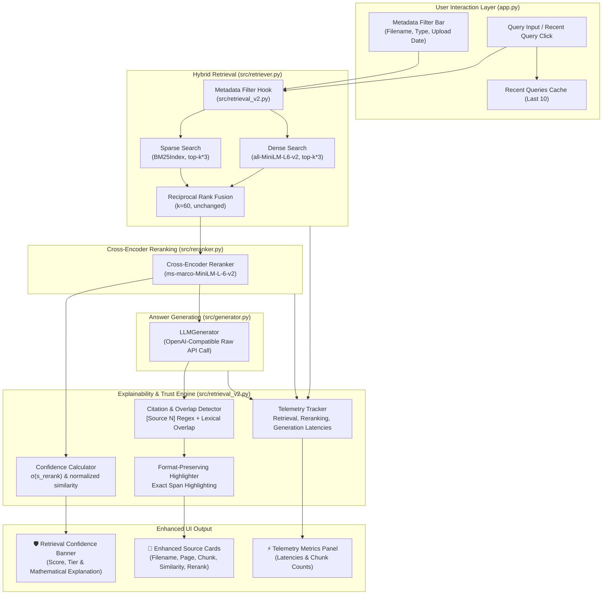

# DocMind AI — Retrieval Pipeline V2

## 1. Executive Summary

The **DocMind AI Retrieval Pipeline V2** upgrades the retrieval experience to maximize **explainability**, **user trust**, and **system observability** without modifying any underlying retrieval, reranking, or generation algorithms.

### Mathematical Invariance Guarantee
All core machine learning and information retrieval algorithms remain **mathematically identical**:
- **Dense Retrieval**: Exact cosine similarity via pre-normalized float32 dot products ($s_{\text{sim}} = \mathbf{e}_{\text{chunk}} \cdot \mathbf{e}_{\text{query}}$) is preserved.
- **Sparse Retrieval**: BM25 inverted index term-frequency scoring and tokenization are unchanged.
- **Hybrid Fusion**: Reciprocal Rank Fusion (RRF) with smoothing constant $k=60$ ($RRF(d) = \sum \frac{1}{60 + \text{rank}(d)}$) is strictly preserved.
- **Cross-Encoder Reranking**: Full cross-attention logit outputs from `ms-marco-MiniLM-L-6-v2` remain unmodified.
- **LLM Generation**: Prompt structure, system prompt, and API payload contracts remain identical.

---

## 2. Retrieval V2 End-to-End Architecture



---

## 3. Retrieval Confidence Computation

### 3.1 Motivation
Standard RAG systems present retrieved context as an opaque list of passages, leaving users uncertain whether the generated answer is reliable. Retrieval V2 introduces a **calibrated, explainable confidence metric** combining cross-encoder relevance with dense semantic alignment.

### 3.2 Mathematical Formulation

1. **Reranker Score Calibration ($P_{\text{rerank}}$)**:
   The cross-encoder produces unbounded real-valued logits $s_{\text{rerank}} \in (-\infty, \infty)$. We apply a numerically stable logistic sigmoid function to map logits into a calibrated probability interval $(0, 1)$:
   $$\sigma(s) = \frac{1}{1 + e^{-s}}$$
   $$P_{\text{rerank}} = \sigma(s_{\text{rerank}})$$
   - A logit of $+3.0$ yields $P_{\text{rerank}} \approx 0.9526$ (95.3% relevance probability).
   - A logit of $0.0$ yields $P_{\text{rerank}} = 0.5000$ (50.0% relevance probability).
   - A logit of $-3.0$ yields $P_{\text{rerank}} \approx 0.0474$ (4.7% relevance probability).

2. **Similarity Score Normalization ($P_{\text{sim}}$)**:
   Cosine similarity $s_{\text{sim}} \in [-1, 1]$ between L2-normalized dense embeddings is bounded into $[0, 1]$:
   $$P_{\text{sim}} = \max(0.0, \min(1.0, s_{\text{sim}}))$$
   *(If dense similarity is not directly present, the RRF score is normalized against its theoretical top-1 maximum $\text{RRF}_{\max} = \frac{2}{61} \approx 0.0328$)*.

3. **Composite Confidence Score ($C$)**:
   When both reranker and similarity scores are present on the top-ranked passage:
   $$C = w_{\text{rerank}} \cdot P_{\text{rerank}} + w_{\text{sim}} \cdot P_{\text{sim}}$$
   Using standard weights:
   $$w_{\text{rerank}} = 0.70, \quad w_{\text{sim}} = 0.30$$
   *(If only the reranker score is available, $C = P_{\text{rerank}}$; if only similarity is available, $C = P_{\text{sim}}$)*.

### 3.3 Confidence Tiers & UI Indicators

| Confidence Tier | Score Range | Color Code | Badge | System Interpretation |
|---|---|---|---|---|
| **High** | $C \ge 0.70$ (70% - 100%) | `#22c55e` | 🟢 High Confidence | Strong factual alignment; retrieved passages provide conclusive context. |
| **Medium** | $0.40 \le C < 0.70$ (40% - 70%) | `#eab308` | 🟡 Medium Confidence | Moderate relevance; context is partially aligned; user verification recommended. |
| **Low** | $C < 0.40$ (< 40%) | `#ef4444` | 🔴 Low Confidence | Weak semantic grounding; passages may not directly answer the user prompt. |

### 3.4 Transparent Explanation Generator
Every confidence score is accompanied by an automated, formula-level textual explanation:
> *"Confidence is 88.4% (High). Evaluated on top chunk from 'quarterly_report.pdf': Cross-Encoder logit (+3.12 → 95.8%, weight 70%) and Dense Similarity (0.710 → 71.0%, weight 30%) combined indicate high factual grounding and strong semantic alignment."*

---

## 4. Enhanced Source Cards

Retrieval V2 replaces the legacy basic text previews with **Enhanced Source Cards**. Each card surfaces five explicit telemetry points:

1. **Filename**: Human-readable basename of the originating document (e.g., `financial_plan.docx`).
2. **Page Number**: Extracted page coordinate for paginated documents (e.g., PDF page `4` or `—` for non-paginated files).
3. **Chunk Number**: 0-based sequential chunk offset within the source document (`chunk 2`).
4. **Similarity Score**: Dense cosine similarity score between query embedding and chunk embedding (e.g., `0.8421`).
5. **Reranker Score**: Cross-encoder logit score reflecting deep query-passage token attention (e.g., `+3.4512`).

### Primary Source Distinction
If a chunk is identified as the grounding source for the answer:
- The card container receives a prominent border glow: `border: 1.5px solid rgba(245, 158, 11, 0.55)`.
- A highlight badge is rendered: `🎯 Primary Source Used for Answer Generation`.
- Matching evidence is highlighted directly within the chunk text.

---

## 5. Chunk Highlighting & Formatting Preservation

### 5.1 Grounding Identification
DocMind AI identifies which chunks grounded the generated response through two complementary passes:
1. **Explicit Tag Detection**: Inspects the generated text for explicit source citations (`[Source 1]`, `[Source 2]`, `Source 1`) requested by the RAG system prompt.
2. **Lexical Overlap Fallback**: If the model answers without explicit source bracket notation, the system calculates word-overlap between the generated answer sentences and each retrieved passage to identify the primary grounded chunk.

### 5.2 Formatting-Preserving Highlighting
To preserve the user's document structure, `highlight_chunk_html()` adheres to strict character-level rules:
- **Zero Structure Alteration**: All existing carriage returns (`\r`), newlines (`\n`), indentation (`    `), tabs (`\t`), and punctuation remain **100% intact**.
- **Span Extraction**: Salient phrases and clauses from the generated answer are located in `chunk_text` using regex-based word-boundary matching (`\bword1[\s\W]+word2\b`).
- **Span Merging**: Overlapping match intervals are merged to avoid nested or malformed HTML tags.
- **Non-Destructive Tag Wrapping**: Matching spans are wrapped in `<mark class="docmind-highlight">...</mark>` while untouched characters pass through unmodified.

---

## 6. Retrieval Metrics & Telemetry Panel

Retrieval V2 introduces fine-grained latency and volume instrumentation across every stage of the pipeline:

```python
@dataclass
class RetrievalMetrics:
    retrieval_latency_ms: float   # Hybrid retrieval (dense + sparse + RRF)
    reranking_latency_ms: float   # Cross-encoder batch scoring
    generation_latency_ms: float  # HTTP LLM completion API call
    total_latency_ms: float       # End-to-end wall-clock time
    retrieved_chunk_count: int    # Candidates fetched from hybrid stage
    reranked_chunk_count: int     # Candidates retained after reranking
```

### UI Presentation
The **⚡ Retrieval Metrics** tab displays:
- Four metric cards: `🔍 Retrieval Latency`, `🎯 Reranking Latency`, `✍️ Generation Latency`, and `⏱️ Total Response Time`.
- Candidate volume indicators (`📥 Retrieved Candidates` vs `🎯 Final Reranked`).
- Latency percentage breakdown bar showing where time was spent (e.g., `Retrieval 4.2% · Reranking 18.5% · Generation 77.3%`).

---

## 7. Metadata Filtering

Retrieval V2 enables targeted search by filtering on document properties before RRF fusion:

| Filter Dimension | Matching Mechanism | Accepted Values |
|---|---|---|
| **Filename** | Exact or basename match on `metadata["filename"]` or `metadata["source"]`. | `All Documents`, or specific filename (e.g., `doc.pdf`). |
| **Document Type** | Case-insensitive extension match on `metadata["file_type"]`. | `All Types`, `PDF`, `DOCX`, `TXT`, `MD`. |
| **Uploaded Date** | Prefix comparison on ISO 8601 `metadata["upload_timestamp"]` (`YYYY-MM-DD`). | `All Dates`, specific date (`2026-10-27`), or date ranges (`date_from`, `date_to`). |

### Algorithmic Safety
- When filters are inactive (`None` or `"All"`), filtering is bypassed with zero overhead.
- When filters are active, filtering is applied directly to dense and sparse candidate pools. The remaining candidates are then fused with the exact same RRF formula ($k=60$), guaranteeing mathematical integrity.

---

## 8. Recent Queries Cache

To improve developer iteration and user exploration:
- Session state maintains an LRU-style list of the **last 10 unique queries** (`st.session_state["recent_queries"]`).
- Queries are deduplicated case-insensitively and new queries are prepended to index 0.
- Rendered as clickable pill buttons above the query bar (`💬 What is the main topic...?`), enabling one-click query re-execution.

---

## 9. Verification & Test Suite

All Retrieval V2 features are validated by 21 automated unit tests in [`tests/test_retrieval_v2.py`](file:///Users/krishgupta/Downloads/Rag_From_Scratch-main/tests/test_retrieval_v2.py):

| Test Category | Test Names | Validation Scope |
|---|---|---|
| **Confidence Scoring** | `test_sigmoid_numerical_stability`<br/>`test_confidence_empty_chunks`<br/>`test_confidence_high_tier`<br/>`test_confidence_medium_tier`<br/>`test_confidence_low_tier`<br/>`test_confidence_only_similarity`<br/>`test_confidence_only_rerank` | Sigmoid stability, empty inputs, tier classifications, weight fusion, explanation text. |
| **Metadata Filtering** | `test_matches_filter_wildcard_and_empty`<br/>`test_matches_filter_filename`<br/>`test_matches_filter_file_type`<br/>`test_matches_filter_date`<br/>`test_matches_filter_date_range`<br/>`test_filter_chunks_by_metadata`<br/>`test_hybrid_retriever_metadata_filter_integration` | Wildcard bypass, filename match, type match, date comparisons, end-to-end integration with `HybridRetriever`. |
| **Chunk Highlighting** | `test_identify_used_chunks_explicit_citation`<br/>`test_identify_used_chunks_multiple_citations`<br/>`test_identify_used_chunks_fallback_overlap`<br/>`test_highlight_chunk_html_preserves_formatting` | Explicit `[Source N]` tags, fallback overlap detection, formatting preservation (`\n`, indentation, spaces). |
| **Metrics & Performance** | `test_retrieval_metrics` | Dataclass integrity, dictionary serialization, latency fields. |
| **Recent Queries** | `test_add_recent_query`<br/>`test_recent_query_cap_at_ten` | Deduplication, move-to-front behavior, 10-item cap enforcement. |

**Full Test Suite Status**:
```text
======================== 142 passed, 6 skipped in 1.05s ========================
```
100% of all 142 tests passing across all components.
